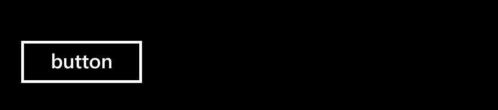
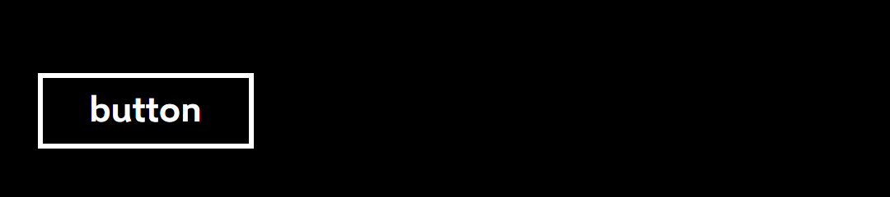
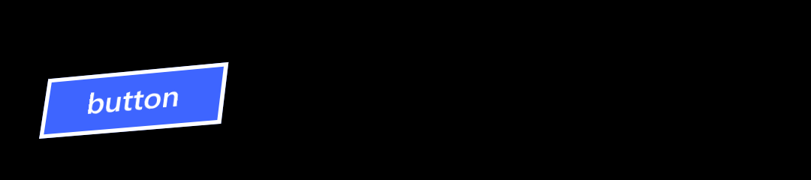
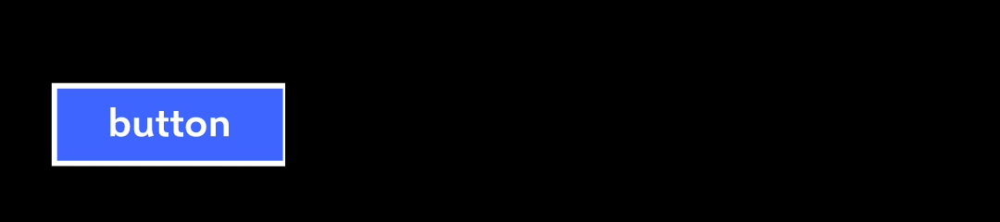
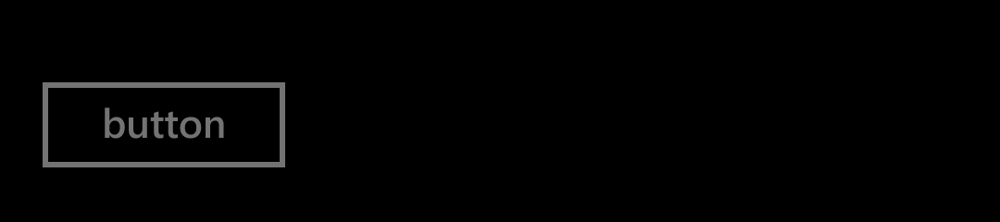
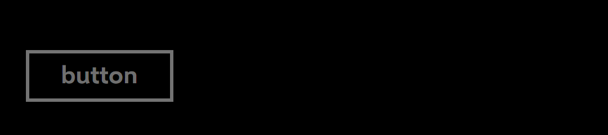
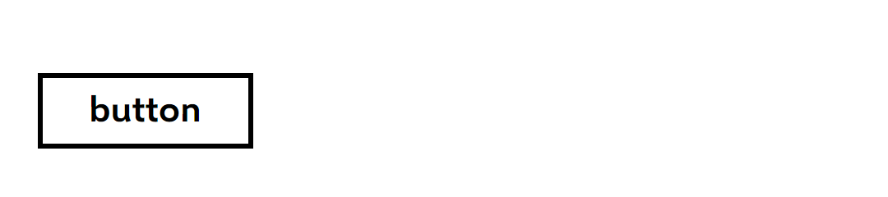
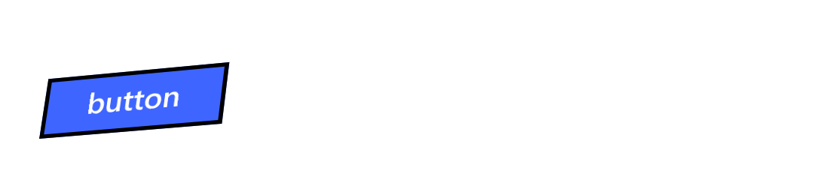
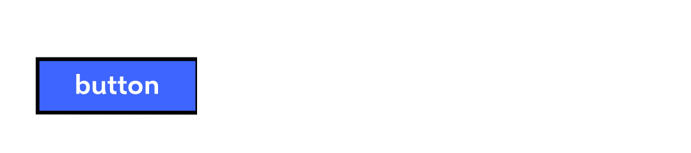
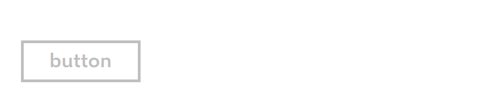

# Button: comparison

**The phone:** the reference app's captures, Emulator 8.1 U1 1080P 5.5 inch (device 11), 1080 × 1920 at 2.4,
2026-11-08, in [`ref/wp81/Button/`](../../../ref/wp81/Button/README.md). Segoe WP Semibold.
**Ours:** headless frames from `tests/Cornflower.Tests/Controls/ButtonFrames.cs`, Avalonia 12.1.4 with Skia, on the
same stage: 450 × 100 at 2.4, the Button in a slot 19 in and 12 down, in [`frames/`](frames). Selawik Semibold.
Ours is pressed by a mouse at the Button's centre and left 160 ms to settle; the phone's Pressed is the state
forced with no finger (below).

Text isn't compared by pixel: the fonts differ by design ([ADR 0001](../../decisions/0001-what-faithful-means.md)).
Sizes, positions and colours are compared by measurement, here and in the tests.

## Dark

| State | Phone | Ours |
|---|---|---|
| `base` |  |  |
| `PointerOver` |  |  |
| `Pressed` |  |  |
| `Disabled` |  |  |

## Light

| State | Phone | Ours |
|---|---|---|
| `base` |  |  |
| `PointerOver` |  |  |
| `Pressed` |  |  |
| `Disabled` |  |  |

`CommonStates.Normal` is byte for byte the phone's `base`, so it isn't shown twice.

## Measurements

In view pixels (DIP) unless raw pixels (px) are said. The phone's numbers are the dumps'; ours are `Bounds` and
the frames.

| | Phone | Ours | |
|---|---|---|---|
| The Button on the stage | 19.1667, 27.5, 109.1667 × 57.5 | the same | **match** |
| `Border` in the Button | 0, 9.5833, 109.1667 × 38.3333 | the same | **match** |
| The content's top, height | 15, 24.1667 | the same | **match** (the phone's 1.33 em line, ADR 0003) |
| The content's left, width | 26.6667, 56.25 | 25.8333, 57.0833 | the font's width: Selawik's "button" is 0.83 wider |
| The first baseline | 34.575 below the Button's top | 34.131 | ADR 0003's 0.025 em, 0.44 DIP high |
| The border, base, `Normal`, `PointerOver` | columns 46–51 and 302–307, rows 89–94 and 175–180; `#FFFFFFFF` dark, `#FF000000` light | the same pixels, the same colours | **match**, every pixel read |
| The border, `Disabled` | the same pixels; `#FF737373` dark, `#FFBFBFBF` light | the same | **match** |
| The page just outside and inside the border | the page's colour | the same | **match** |
| `Pressed`: the background | `#FF3E65FF` (the dump; the accent) | `#FF3E65FF`, brush and pixel (75, 135) | **match** |
| `Pressed`: the text, the border | `#FFFFFFFF` both variants; the border unchanged | the same | **match** |
| `Disabled`: the text | `#73FFFFFF` dark, `#40000000` light | the same | **match** |
| The tilt under a finger, button A of run 2307 (120 × 60), 25 presses | the readings | each within 0.04° and 0.085 px | **match** |
| A tap 0.84, 1.7 and 3.35 px inside each tilted edge, run 0822 | clicks, 12 of 12 | clicks, 12 of 12 | **match** |

## Behaviours

| # | Behaviour | Result | Measurement |
|---|---|---|---|
| 1 | The style's values | **Match** | Each setter equals `button.json`'s key's value and the dump's reading, dark and light |
| 2 | Bounds | **Match** | Above; the 109 minimum rounds to 262 px on both sides |
| 3 | Content centred | **Match** | Centred across within 0.5 in a 300-wide Button; 5.4167 below the Border's top |
| 4 | A string's line | **Match**, with ADR 0003's baseline | 24.1276 at 18.14; 39.90 at 30 |
| 5 | The border's pixels | **Match** | 32 pixels per frame, dark and light |
| 6 | Disabled | **Match** | Above; an app's background is taken away, as `ButtonDisabledBackgroundThemeBrush` does |
| 7 | Pressed | **Match** for the colours; the tilt, see below | Above |
| 8 | PointerOver changes nothing | **Match** | The phone's PointerOver PNGs equal `base`'s byte for byte; ours draw the same border pixels |
| 9 | Follows the variant | **Match** | The border pixels after a change from dark to light |
| 10, 11 | The tilt on the whole Button | **Match** | Above |
| 12, 13 | Edge taps and the overhang click | **Match** | Above |

## Gaps and deliberate differences

- **The Pressed capture's tilt isn't a finger's.** The capture forces `Pressed` with `VisualStateManager.GoToState`,
  so its `PointerDownThemeAnimation` runs with no press point and leaves `Grid` at −17.19°, 17.19°. Ours is pressed
  at the centre, so it sinks and leans towards the window's centre. The tilt is compared with the probes' readings
  instead, which match. A real-touch capture of Pressed is owed for the picture.
- **The text's baseline** is 0.44 DIP (1 px) above the phone's: ADR 0003's recorded deviation for the 1.33 em line.
- **The text is Selawik**, so its width differs: 0.83 DIP wider for "button" (ADR 0001).
- **Content that isn't a string** keeps its own line: only the `TextBlock` the presenter makes for a string gets
  the phone's 1.33 em. An app's `TextBlock` inside a Button has Selawik's 1.2 em unless it has a text style.
- **Sliding off while pressed** isn't measured on the phone. Avalonia's Button stays `:pressed` until release; the
  tilt returns as the phone's does (run 2118). Owed: a probe.
- **Rounding**: none shows here; the minimum width rounds to the same 262 px on both sides (ADR 0003).
