# CheckBox: comparison

**The phone:** the reference app's captures, Emulator 8.1 U1 1080P 5.5 inch (device 11), 1080 × 1920 at 2.4,
2026-11-08, in [`ref/wp81/CheckBox/`](../../../ref/wp81/CheckBox/README.md). Segoe WP.
**Ours:** headless frames from `tests/Cornflower.Tests/Controls/CheckBoxFrames.cs`, Avalonia 12.1.4 with Skia, on
the same stage: 450 × 100 at 2.4, the CheckBox in a slot 19 in and 12 down, in [`frames/`](frames). Selawik.
Ours is pressed by a mouse at the box's centre and left 160 ms to settle; the phone's Pressed is the state forced
with no finger (below).

Text isn't compared by pixel: the fonts differ by design ([ADR 0001](../../decisions/0001-what-faithful-means.md)).
Sizes, positions and colours are compared by measurement, here and in the tests.

## Dark

| State | Phone | Ours |
|---|---|---|
| checked, `base` |  | 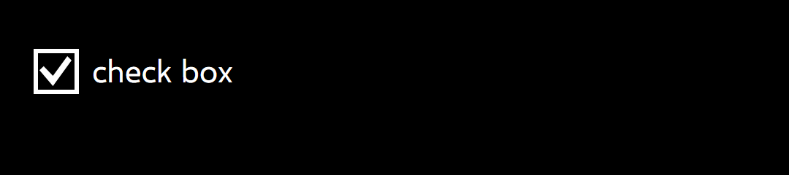 |
| checked, `Pressed` |  |  |
| checked, `Disabled` |  | 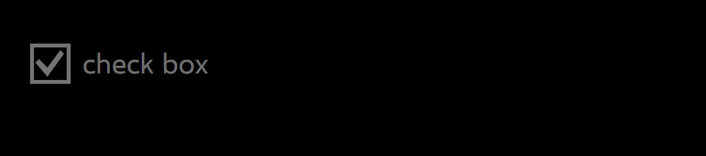 |
| unchecked, `base` |  |  |
| unchecked, `Pressed` |  |  |
| unchecked, `Disabled` |  |  |
| indeterminate, `base` |  | 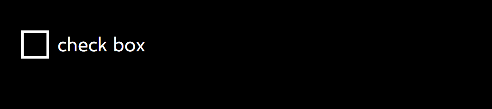 |
| indeterminate, `Pressed` | 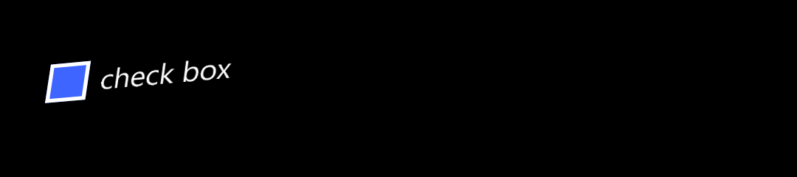 |  |
| indeterminate, `Disabled` |  | 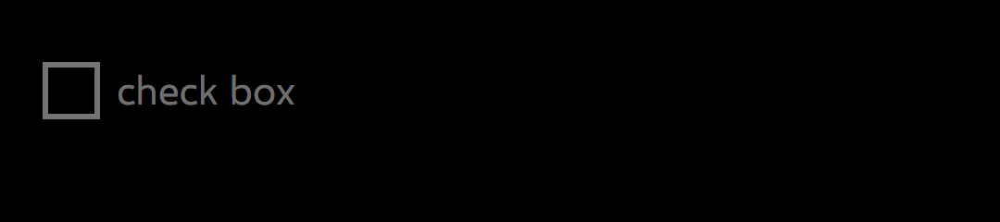 |

## Light

| State | Phone | Ours |
|---|---|---|
| checked, `base` |  | 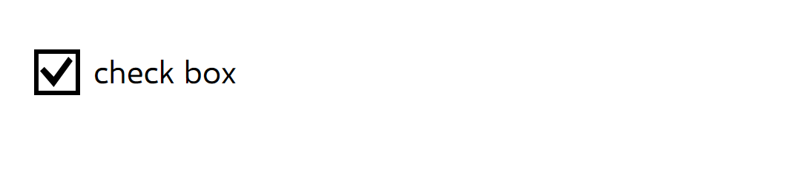 |
| checked, `Pressed` |  |  |
| checked, `Disabled` |  | 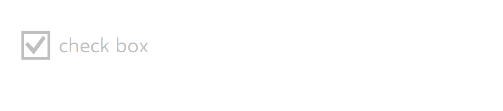 |
| unchecked, `base` | 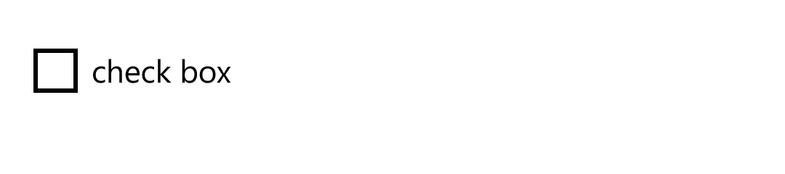 | 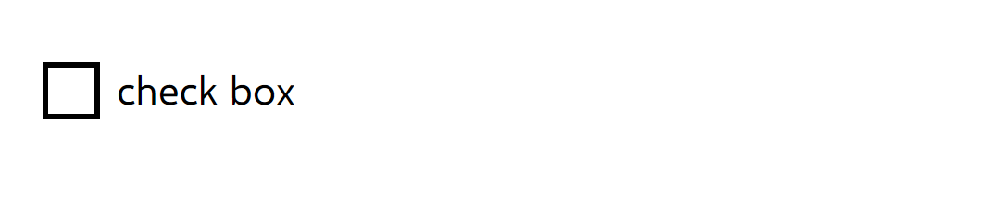 |
| unchecked, `Pressed` | 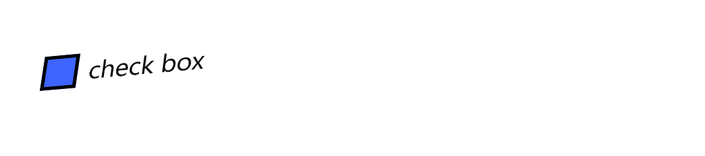 | 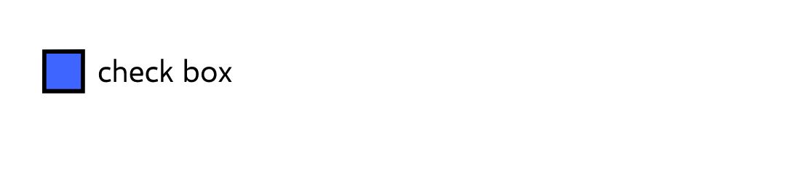 |
| unchecked, `Disabled` |  |  |
| indeterminate, `base` |  |  |
| indeterminate, `Pressed` |  |  |
| indeterminate, `Disabled` |  | 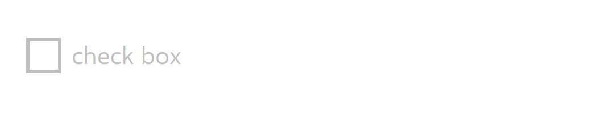 |

`CommonStates.Normal`, `PointerOver` and `MouseOver` are byte for byte the phone's `base` for each variant, so
they aren't shown; `ref/wp81/CheckBox/` keeps the checked `PointerOver` as the evidence.

## Measurements

In view pixels (DIP) unless raw pixels (px) are said. The phone's numbers are the dumps'; ours are `Bounds` and
the frames.

| | Phone | Ours | |
|---|---|---|---|
| The CheckBox on the stage | 19.1667, 12.0833, 167.9167 × 57.5 | 19.1667, 12.0833, 168.3333 × 57.5 | **deliberate difference**, ADR 0003: 168 is 403.2 px, rounded up to 404. Nothing is drawn there |
| `Grid` in the CheckBox | 0, 15.8333, 25.4167 tall | 0, 15.8333, 25.8333 tall | the box's rounding, below |
| The box, `CheckBackground` | 0, 15.8333, 25.4167 square (61 px) | 0, 15.8333, 25.8333 square (62 px) | **deliberate difference**, ADR 0003: the left and top sides match, the right and bottom are 1 px out |
| The border, every state but `Pressed` | columns 46–51 and 101–106, rows 67–72 and 122–127 | columns 46–51 and 102–107, rows 67–72 and 123–128 | the same 6 px wide; the right and bottom 1 px out, as above |
| The border's colour | `#FFFFFFFF` dark, `#FF000000` light; disabled `#FF737373` dark, `#FFBFBFBF` light | the same | **match**, every pixel read |
| The page just outside and inside the border | the page's colour | the same | **match** |
| The tick | 3.75, 4.1667 in the box, 18.3333 × 17.0833: raw (55, 77), 44 × 41 | 3.3333, 4.1667, 18.3333 × 17.0833: raw (54, 77), 44 × 41 | the same shape (`GlyphTests`) and height; **deliberate difference**, 1 px left: centred, it is 8.5 px in, which the phone rounds up and Avalonia down |
| The tick's colour | `#FFFFFFFF` dark, `#FF000000` light; pressed `#FFFFFFFF`; disabled `#73FFFFFF` dark, `#40000000` light | the same, brush and pixels | **match** |
| `NormalRectangle`, indeterminate | 6.25, 6.25 in the box, 12.9167 square, `#00FFFFFF` | 5.8333, 6.25, 13.3333 square, `#00FFFFFF` | invisible on both: the frames of indeterminate and unchecked are the same, pixel for pixel, on both sides |
| `Pressed`: the box | `#FF3E65FF` (the dump; the accent); the border unchanged | the same, brush and pixels round the tick | **match** |
| `Pressed`: the rectangle | `#FF3E65FF` | the same | **match** (the accent on the accent) |
| `Pressed`, `Disabled`: the text | unchanged pressed; `#73FFFFFF` dark, `#40000000` light disabled | the same | **match** |
| The content's left, top, height | 33.3333, 15.8333, 24.1667 | the same | **match** (the 25.5 column rounds to the nearest in both; the phone's 1.33 em line, ADR 0003) |
| The content's width | 79.8967 ("check box" in Segoe WP) | 80.4167 | the font's width |

## Behaviours

| # | Behaviour | Result | Measurement |
|---|---|---|---|
| 1 | The style's values | **Match** | Each setter equals `checkbox.json`'s key's value and the dump's reading, dark and light |
| 2 | Bounds | **Match**, with ADR 0003's rounding | Above |
| 3 | The text's font is the presenter's | **Match** | The CheckBox at 30, Bold, Courier New: its text 18.14, Normal, `PhoneFontFamilyNormal` |
| 4 | Data's line, templates, access keys | **Match**; access keys a deliberate difference | 1.33 em; as Button |
| 5 | The box's pixels | **Match**, with ADR 0003's rounding | 24 border pixels and 8 page pixels per frame, dark and light |
| 6 | Checked, unchecked, indeterminate | **Match** | The tick's pixels; indeterminate's frame equals unchecked's, as the phone's PNGs do |
| 7 | Pressed | **Match** for the colours; the tilt, see below | Above |
| 8 | Disabled | **Match** | Above; an app's background stays, as the phone's state leaves it |
| 9 | The pointer over it changes nothing | **Match** | The phone's PNGs equal `base`'s; ours, the frame before and after |
| 10 | A tap toggles, through indeterminate | **Match** (WinRT's and Avalonia's order) | true, null, false from unchecked, three-state |
| 11, 12 | The tilt on `Grid`; a tap on the overhang and the text toggles | **Match** for the shape | Above; the tilt's values under a finger aren't measured on a CheckBox |
| 13 | Keyboard focus draws nothing | **Match** | No adorner |
| 14 | Follows the variant | **Match** | The border and tick pixels after a change from dark to light |
| 18 | A hole's CheckBox keeps the theme under Wp81 | not applicable on the phone | `ManagedFileChooser`'s: Simple's CheckBox theme and width, no tilt |

## Gaps and deliberate differences

- **The Pressed capture's tilt isn't a finger's.** The capture forces `Pressed` with no press point. Ours is pressed
  at the box's centre, so it leans towards the box. A real-touch capture of Pressed, and a tilt probe on a
  CheckBox, are owed. A press in the overhang is outside `Grid`, the tilt's target; `Tilt` takes the tilt of the
  nearest edge there, unmeasured on the phone.
- **Rounding** (ADR 0003): the box is 1 px wider and taller than the phone's at its right and bottom, and the tick
  1 px left of the phone's. The CheckBox is 0.42 wider, which draws nothing.
- **The text's baseline** is ADR 0003's 0.025 em above the phone's, and the text is Selawik (ADR 0001).
- **Access keys** are Avalonia's, as in Button.
- **`Foreground` is set by the theme**, where the phone's inherits it from the page (PLAN, "Decided on the user's
  behalf").
