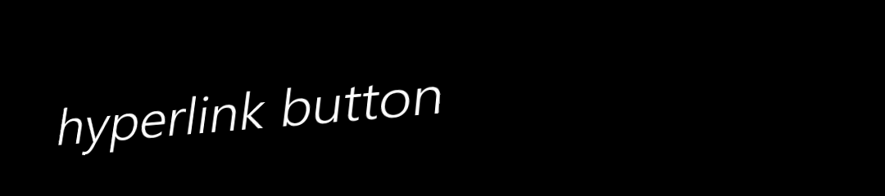
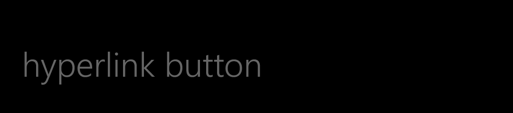
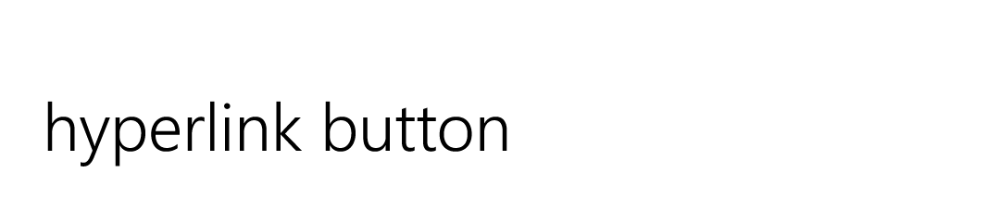
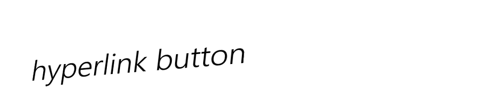
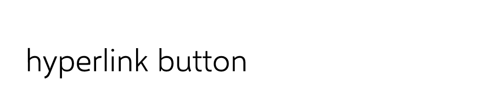
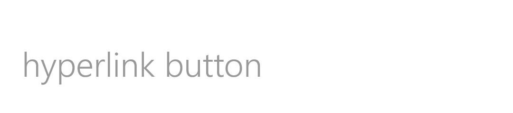

# HyperlinkButton: comparison

**The phone:** the reference app's captures, Emulator 8.1 U1 1080P 5.5 inch (device 11), 1080 × 1920 at 2.4,
2026-11-08, in [`ref/wp81/HyperlinkButton/`](../../../ref/wp81/HyperlinkButton/README.md). Segoe WP Semilight.
**Ours:** headless frames from `tests/Cornflower.Tests/Controls/HyperlinkButtonFrames.cs`, Avalonia 12.1.4 with Skia,
on the same stage: 450 × 100 at 2.4, the HyperlinkButton in a slot 19 in and 12 down, in [`frames/`](frames). Selawik
Semilight. Ours is pressed by a mouse at the control's centre and left 160 ms to settle; the phone's Pressed is the
state forced with no finger (below).

Text isn't compared by pixel: the fonts differ by design ([ADR 0001](../../decisions/0001-what-faithful-means.md)).
Sizes, positions and colours are compared by measurement, here and in the tests.

## Dark

| State | Phone | Ours |
|---|---|---|
| `base` |  |  |
| `PointerOver` |  |  |
| `Pressed` |  |  |
| `Disabled` |  |  |

## Light

| State | Phone | Ours |
|---|---|---|
| `base` |  |  |
| `PointerOver` |  |  |
| `Pressed` |  |  |
| `Disabled` |  |  |

`CommonStates.Normal` is byte for byte the phone's `base`, so it isn't shown twice.

## Measurements

In view pixels (DIP) unless raw pixels (px) are said. The phone's numbers are the dumps'; ours are `Bounds` and the
frames.

| | Phone | Ours | |
|---|---|---|---|
| The control on the stage | 19.1667, 32.5, 211.25 × 47.0833 | 19.1667, 32.5, 211.6667 × 47.0833 | **match** but the width, the font's: Selawik's "hyperlink button" is 0.42 wider |
| `Grid`, `Border` | fill the control | the same | **match** |
| The presenter's top, height | 2.9167, 40 | the same | **match** |
| The text's line | 39.7167 (1.33 em at 29.86) | 39.7161 | **match** (ADR 0003's 1.33 em) |
| The ink, left to right | px 51 to 547, 497 px | px 51 to 548, 498 px | the font's |
| The ink, top to bottom | rows 109 to 179 | rows 108 to 177 | the font's: Selawik's descender is shorter |
| The baseline | row 163 | row 161 | 2 px (0.83 DIP) high: ADR 0003's 0.025 em at 29.86 is 0.75 |
| Underline | none: the longest run of ink on a row is 31 px | none | **match** |
| The text, base and `PointerOver` | glyph insides `#FFFFFFFF` dark, `#FF000000` light | the same | **match** |
| The text, `Disabled` | `#66FFFFFF` / `#66000000` (the dump), drawn `#FF666666` / `#FF999999` | the same, brush and pixels | **match** |
| `Pressed`: colours | none changed: the dump's foreground is the rest's, and the PNG is all greys | the same | **match** |
| `Pressed`: what tilts | the `ContentPresenter`; `Grid` and `Border` keep their bounds | `PART_ContentPresenter`; `Grid` and `Border` untransformed | **match** |
| The tilt under a finger, a presenter of button A's bounds (run 2307, 120 × 60), 25 presses | the readings (on a Button's `Grid`) | each within 0.04° and 0.085 px | **match** for the rule; not read on a HyperlinkButton |
| A tap 0.84, 1.7 and 3.35 px inside each tilted edge, run 0822 | clicks, 12 of 12 (a Button) | clicks, 12 of 12 | **match** for the rule |

## Behaviours

| # | Behaviour | Result | Measurement |
|---|---|---|---|
| 1 | The style's values | **Match** | Each setter equals `hyperlinkbutton.json`'s key's value or literal, and the dump's reading, dark and light |
| 2 | Bounds | **Match**, but the width (the font's) | Above |
| 3 | Content centred | **Match** | Centred within 0.5 in a 400 × 80 control, across and down |
| 4 | Data's line | **Match**, with ADR 0003's baseline | 39.7161 at 29.86 |
| 5 | No underline | **Match** | The longest ink run is under an eighth of the text's width; no `TextDecorations` |
| 6 | The text's colour | **Match** | The commonest ink, dark and light |
| 7 | Disabled | **Match** | Above; an app's background stays, as the phone's Disabled sets only the text |
| 8 | Pressed changes no colour | **Match** | No pixel but greys, the text's colour kept |
| 9 | PointerOver and visited change nothing | **Match** | The phone's PointerOver PNGs equal `base`'s byte for byte; ours too, and `:visited`'s |
| 10 | Keyboard focus | **Match** | No adorner |
| 11 | Follows the variant | **Match** | The ink after a change from dark to light |
| 12 | Access keys | Deliberate difference, as in the Button's theme | `_Open` draws `Open` and Alt+O clicks |
| 13, 14 | The tilt on the presenter alone | **Match** for where and how much | Above |
| 15, 16 | Edge taps and the padding click | **Match** | Above; with a null background too, a deliberate difference (below) |

## Gaps and deliberate differences

- **The release isn't measured.** The phone's template has no transitions, so leaving `Pressed` likely puts the
  presenter straight back; ours holds 182.6 ms and eases back over 167 ms, as `Tilt` does for the Button, whose
  release was measured. Owed: a probe pressing a HyperlinkButton.
- **The tilt's rule is the Button's.** No probe has pressed a HyperlinkButton. The rule is the
  `PointerDownThemeAnimation`'s for any element, and the forced Pressed capture puts it on the presenter with the
  same −17.19°, 17.19° as a Button's `Grid`, so it is taken as the same.
- **The Pressed capture's tilt isn't a finger's**, as for the Button: forced with no press point, −17.19°, 17.19°.
  Ours is pressed at the centre, so it only sinks.
- **The text is Selawik Semilight**: 0.42 DIP wider for "hyperlink button", its baseline 0.83 DIP above the phone's
  (ADR 0003).
- **Access keys** are Avalonia's, as in the Button's theme.
- **Visited** draws nothing: the phone has no such state. `IsVisited` and `:visited` still work for an app's own
  style.
- **No hand cursor**, unlike Simple's: the phone has no cursor. Decided in the PR.
- **`Grid` has a transparent background**, where the phone's has none. It shows only when an app sets `Background` to
  null: ours still takes a press anywhere on the control, as `Tilt` needs; the phone's would take it on the text only.
