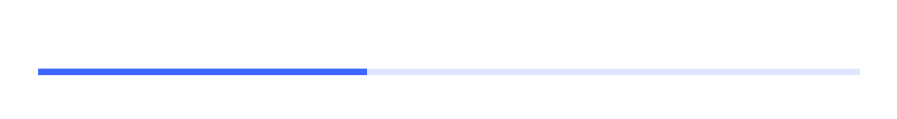
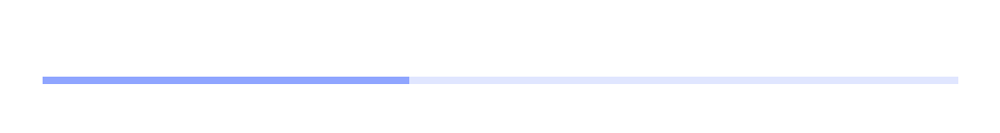
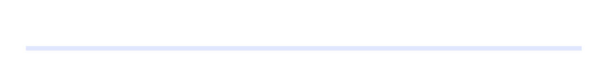
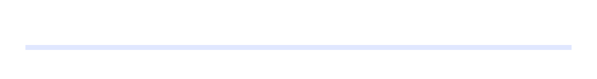

# ProgressBar: comparison

**The phone:** the reference app's captures, Emulator 8.1 U1 1080P 5.5 inch (device 11), 1080 × 1920 at 2.4,
2026-11-08, in [`ref/wp81/ProgressBar/`](../../../ref/wp81/ProgressBar/README.md): the catalogue's 40% bar and its
indeterminate bar, stretched across their slot. **Ours:** headless frames from
`tests/Cornflower.Tests/Controls/ProgressBarFrames.cs`, Avalonia 12.1.4 with Skia, on the same stage: 450 × 60 at 2.4,
the bar in a slot 19 in and 12 down, in [`frames/`](frames). No text on either.

**Avalonia's bar is determinate or indeterminate**, so each of the phone's forced states is drawn as the nearest of the
two. `Determinate` and `Updating` draw as the bar at rest on the phone too. `Paused` and `Error` can't be reached
(no `ShowPaused` or `ShowError`), so ours is the bar at rest: those two are the gaps. The indeterminate bar's forced
states all show the track alone on the phone (forcing a state stopped its storyboard, and its value is 0), so ours is
drawn at 0%.

**The indeterminate pictures are moments of the running storyboard**, so ours is drawn at the same moment, on the
emulator's 64 Hz frames. The 40% bar's forced `Indeterminate` shows two dots; the storyboard puts them there at 31/64 s
(dark) and 29/64 s (light), fitted from the dots' edges (their accent pixels' coverage), within 0.015. Each dump beside
it was taken a frame later, and is checked by the tests. The indeterminate bar at rest shows nothing: its dumps put
its one dot left of the bar at 9/64 and 10/64 s, and the bar clips it. Ours is drawn at 9/64 s.

## Dark

| Capture | Phone | Ours, drawn as |
|---|---|---|
| `value-40 base` |  |  40% |
| `value-40 CommonStates.Determinate` |  |  40% |
| `value-40 CommonStates.Updating` |  |  40% |
| `value-40 CommonStates.Paused` |  |  40%: **gap**, no `Paused` |
| `value-40 CommonStates.Error` |  |  40%: **gap**, no `Error` |
| `value-40 CommonStates.Indeterminate` |  |  indeterminate, at the picture's moment |
| `indeterminate base` |  |  indeterminate, at 9/64 s |
| `indeterminate CommonStates.Determinate` |  |  0% |
| `indeterminate CommonStates.Updating` |  |  0% |
| `indeterminate CommonStates.Paused` |  |  0% |
| `indeterminate CommonStates.Error` |  |  0% |
| `indeterminate CommonStates.Indeterminate` |  |  0%, as the picture shows |

## Light

| Capture | Phone | Ours, drawn as |
|---|---|---|
| `value-40 base` |  |  40% |
| `value-40 CommonStates.Determinate` |  |  40% |
| `value-40 CommonStates.Updating` |  |  40% |
| `value-40 CommonStates.Paused` |  |  40%: **gap**, no `Paused` |
| `value-40 CommonStates.Error` |  |  40%: **gap**, no `Error` |
| `value-40 CommonStates.Indeterminate` |  |  indeterminate, at the picture's moment |
| `indeterminate base` |  |  indeterminate, at 9/64 s |
| `indeterminate CommonStates.Determinate` |  |  0% |
| `indeterminate CommonStates.Updating` |  |  0% |
| `indeterminate CommonStates.Paused` |  |  0% |
| `indeterminate CommonStates.Error` |  |  0% |
| `indeterminate CommonStates.Indeterminate` |  |  0%, as the picture shows |

## Measurements

In view pixels (DIP) unless raw pixels (px) are said. The phone's numbers are the dumps' and the pictures'; ours are
`Bounds` and our frames, measured the same way, across row 86.

| | Phone | Ours | |
|---|---|---|---|
| The bar on the stage | 46 to 1034 px across, rows 83 to 90 | 46 to 1033 px, rows 82 to 90 | **gap**: 1 px narrower (Avalonia rounds the slot's margins, the phone the bar's edges) and 1 px taller (3.5 is 8.4 px: the phone rounds to the nearest, Avalonia up; ADR 0003) |
| The indicator at 40% | 46 to 441 px (396), `#FF3E65FF` | the same | **match** |
| The track | `#0A1029` dark, `#E0E6FF` light | `#091028`, `#E0E7FF` | **match** within one step: the accent at 0.16, blended |
| The page beside it | `#000000` / `#FFFFFF` | the same | **match** |
| The dots at rest | 0, 12.5, 25, 37.5, 50 in the bar | the same | **match**, with layout rounding off in the grid (Avalonia would put them 12.92 apart) |
| A dot | 8 px across, 3.33 | 8.4 px, 3.5 | **gap**: 0.4 px wider; the phone rounds the 3.5 to 8 px, and ours isn't rounded so the pitch can be 12.5 |
| The dots at 31/64 s (dark) | left edges at 83.13 and 221.26 px | 83.08 and 221.08 px | **match** within 0.2 px |
| The dots at 29/64 s (light) | 62.12 and 194.75 px | 62.00 and 194.61 px | **match** within 0.2 px |
| The dots' colour | the accent | the same | **match** |
| Indeterminate: the track | hidden | hidden | **match** |
| A dot left of the bar | not drawn: the bar's `Clip` | not drawn: `ClipToBounds` | **match** |
| `TemplateSettings` | seven profiles' readings | the formulas, within 0.0005 | **match** |
| The storyboard | six moments the dumps caught, up to four dots at once | each is one time in ours, a 64 Hz frame, the grid within 0.001 and every dot within 0.013 | **match** |
| `Paused` | the indicator at 0.5 | at rest | **gap**: no `ShowPaused` |
| `Error` | no indicator | at rest | **gap**: no `ShowError` |
| Disabled | not captured: the template has no `Disabled` state | drawn as enabled | **match**, by the template |

The phone's dots are a little narrower than ours and their edges fall on other fractions of a pixel, so the edge pixels'
shades differ; the dots' places agree.

## Not compared

- **The motion against a recording.** No recording of an indeterminate bar was made; the dumps' six moments check the
  storyboard more finely than a recording at the emulator's window zoom would.
- **A value change, and leaving indeterminate.** The phone's transitions (the indicator's reposition, the grid's fade)
  aren't recorded, and aren't drawn here.
