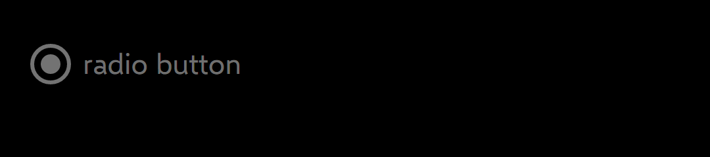
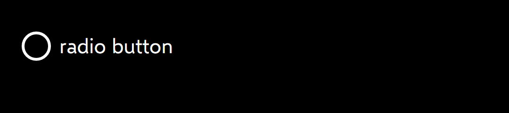
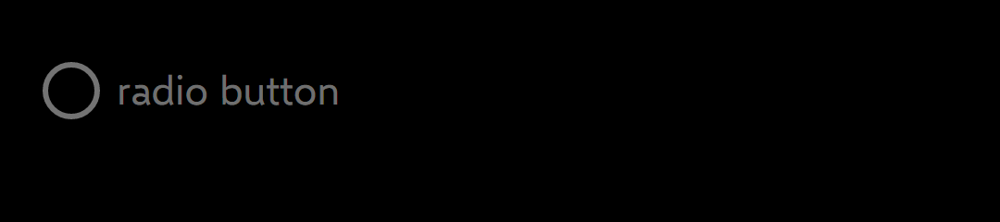
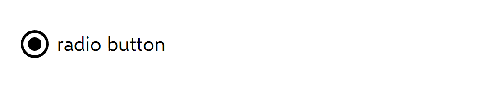
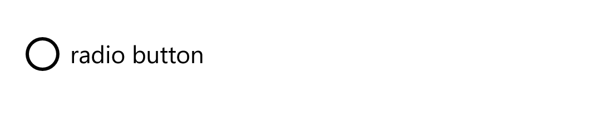
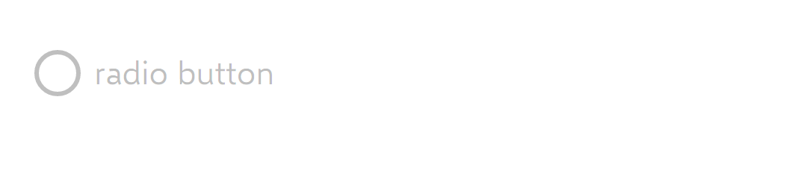

# RadioButton: comparison

**The phone:** the reference app's captures, Emulator 8.1 U1 1080P 5.5 inch (device 11), 1080 × 1920 at 2.4,
2026-11-08, in [`ref/wp81/RadioButton/`](../../../ref/wp81/RadioButton/README.md). Segoe WP.
**Ours:** headless frames from `tests/Cornflower.Tests/Controls/RadioButtonFrames.cs`, Avalonia 12.1.4 with Skia, on
the same stage: 450 × 100 at 2.4, the RadioButton in a slot 19 in and 12 down, in [`frames/`](frames). Selawik.
Ours is pressed by a mouse at the circle's centre and left 160 ms to settle; the phone's Pressed is the state forced
with no finger (below).

Text isn't compared by pixel: the fonts differ by design ([ADR 0001](../../decisions/0001-what-faithful-means.md)).
Sizes, positions and colours are compared by measurement, here and in the tests.

## Dark

| State | Phone | Ours |
|---|---|---|
| checked, `base` |  |  |
| checked, `Pressed` |  |  |
| checked, `Disabled` |  |  |
| unchecked, `base` |  |  |
| unchecked, `Pressed` |  |  |
| unchecked, `Disabled` |  |  |

## Light

| State | Phone | Ours |
|---|---|---|
| checked, `base` |  |  |
| checked, `Pressed` |  |  |
| checked, `Disabled` |  |  |
| unchecked, `base` |  |  |
| unchecked, `Pressed` |  |  |
| unchecked, `Disabled` |  |  |

`CommonStates.Normal`, `PointerOver` and `MouseOver` are byte for byte the phone's `base` for each variant, and
`CheckStates.Indeterminate` its unchecked `base`, so they aren't shown; `ref/wp81/RadioButton/` keeps the checked
`PointerOver` as the evidence.

## Measurements

In view pixels (DIP) unless raw pixels (px) are said. The phone's numbers are the dumps'; ours are `Bounds` and
the frames. The pixels are read on the circle's middle row (97) and column (76).

| | Phone | Ours | |
|---|---|---|---|
| The RadioButton on the stage | 19.1667, 12.0833, 167.9167 × 57.5 | 19.1667, 12.0833, 168.3333 × 57.5 | **deliberate difference**, ADR 0003: 168 is 403.2 px, rounded up to 404. Nothing is drawn there |
| `Container` in the RadioButton | 0, 15.8333, 25.4167 tall | 0, 15.8333, 25.8333 tall | the circle's rounding, below |
| The circle, `CheckBackground` | 0, 15.8333, 25.4167 across (61 px) | 0, 15.8333, 25.8333 across (62 px) | **deliberate difference**, ADR 0003: the left and top match, the right and bottom are 1 px out |
| The ring, every state | columns 46–51 and 101–106 (100 a trace, 106 nearly whole), rows 67–72 and 122–127 | columns 46–51 and 102–107, rows 67–72 and 123–128 | the same 6 px wide (2.5); the right and bottom 1 px out, as above |
| The ring's colour | `#FFFFFFFF` dark, `#FF000000` light; disabled `#FF737373` dark, `#FFBFBFBF` light | the same | **match**, every pixel read |
| The page just outside and inside the ring | the page's colour | the same | **match** |
| The dot, `CheckMark` | 6.6667, 6.6667 in the circle, 12.5 across: columns 62–91, rows 83–112 | the same, on the same pixels | **match**: centred across, it is 15.5 px in; the phone rounds up, and Avalonia rounds the half to even, 16 |
| The dot's colour | `#FFFFFFFF` dark, `#FF000000` light; pressed `#FFFFFFFF`; disabled `#73FFFFFF` dark, `#40000000` light | the same, brush and pixels | **match** |
| `Pressed`: the circle | `#FF3E65FF` (the PNGs; the accent); the ring unchanged | the same, brush and pixels round the dot | **match** |
| `Pressed`, `Disabled`: the text | unchanged pressed; `#73FFFFFF` dark, `#40000000` light disabled | the same | **match** |
| The empty TextBlock in the circle's cell | 24.1276 tall, 0 wide | `PhoneLineSpacer`, 24.1667 tall, 0 wide | Nothing drawn; the cell is the circle's height on both |
| The content's left, top, height | 33.3333, 15.8333, 24.1667 | the same | **match** (the 25.5 column rounds to the nearest in both; the phone's 1.33 em line, ADR 0003) |
| The content's width | 100.4167 ("radio button" in Segoe WP) | 100.4167 | the font's width, the same here by chance |

## Behaviours

| # | Behaviour | Result | Measurement |
|---|---|---|---|
| 1 | The style's values | **Match** | Each setter equals `radiobutton.json`'s key's value and the dump's reading, dark and light |
| 2 | The text's font is the RadioButton's | **Match** | The RadioButton at 30, Courier New: its text at 30, Courier New |
| 3 | Bounds | **Match**, with ADR 0003's rounding | Above |
| 4 | A larger font centres the circle on the first line | **Match** for the template's rule | At 30: the cell 39.9 tall, the circle's middle on the text's, within a raw pixel. Not captured on the phone; read from the template. An app's `TextBlock` style doesn't move it; the dot is centred on the circle both ways at 1.75, 2.4 and 3.0 |
| 5 | Data's line, templates, access keys | **Match**; access keys a deliberate difference | 1.33 em; as Button |
| 6 | The ring's pixels | **Match**, with ADR 0003's rounding | 24 ring pixels and 8 page pixels per frame, dark and light |
| 7 | Checked, unchecked, indeterminate | **Match** | The dot's ends and middle, and the page past them; indeterminate's frame equals unchecked's, as the phone's PNGs do |
| 8 | Pressed | **Match** for the colours; the tilt, see below | Above |
| 9 | Disabled | **Match** | Above; an app's background stays, as the phone's state leaves it |
| 10 | The pointer over it changes nothing | **Match** | The phone's PNGs equal `base`'s; ours, the frame before and after |
| 11, 12 | A tap checks it, another leaves it checked; a tap on the overhang and the text checks it | **Match** (WinRT's and Avalonia's rule) | |
| 13 | The tilt on `Container` | **Match** for the shape | Above; the tilt's values under a finger aren't measured on a RadioButton |
| 14 | Keyboard focus draws nothing | **Match** | No adorner |
| 15 | Follows the variant | **Match** | The ring and dot pixels after a change from dark to light |
| 16 | One checked per group | **Match** (Avalonia's, as WinRT's) | A tap on another in the parent moves the dot; another parent's stays; a `GroupName` spans parents |

## Gaps and deliberate differences

- **The Pressed capture's tilt isn't a finger's.** The capture forces `Pressed` with no press point. Ours is pressed
  at the circle's centre, so it leans towards the circle. A real-touch capture of Pressed, and a tilt probe on a
  RadioButton, are owed.
- **The release** eases back as the Button's does; the template has no transition, so the phone's may snap back
  (PLAN, "The release"). Not measured.
- **Rounding** (ADR 0003): the circle is 1 px wider and taller than the phone's at its right and bottom. The
  RadioButton is 0.42 wider, which draws nothing.
- **The text's baseline** is ADR 0003's 0.025 em above the phone's, and the text is Selawik (ADR 0001).
- **Access keys** are Avalonia's, as in Button.
- **`Foreground` is set by the theme**, where the phone's inherits it from the page (PLAN, "Decided on the user's
  behalf").
