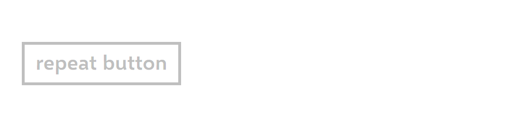

# RepeatButton: comparison

**The phone:** the reference app's captures, Emulator 8.1 U1 1080P 5.5 inch (device 11), 1080 × 1920 at 2.4,
2026-11-08, in [`ref/wp81/RepeatButton/`](../../../ref/wp81/RepeatButton/README.md), Segoe WP Semibold; and the probe of
run `20261112-0755-dev11` for the timing.
**Ours:** headless frames from `tests/Cornflower.Tests/Controls/ToggleButtonFrames.cs`, Avalonia 12.1.4 with Skia, on the
same stage, in [`frames/`](frames), Selawik Semibold; pressed by a mouse at the centre. The timing is ours headless, on
real time.

## Dark

| State | Phone | Ours |
|---|---|---|
| `base` (also `Normal`, `PointerOver`) |  |  |
| `Pressed` |  |  |
| `Disabled` |  |  |

## Light

| State | Phone | Ours |
|---|---|---|
| `base` |  |  |
| `Pressed` |  |  |
| `Disabled` |  |  |

## Measurements

| | Phone | Ours | |
|---|---|---|---|
| The RepeatButton on the stage | 19.1667, 27.5, 137.9167 × 57.5 | 19.1667, 27.5, 140 × 57.5 | **match** but the width: Selawik's "repeat button" is 2.08 wider |
| `Border` in it, the content's top and height | 9.5833 down, 38.3333 tall; 15, 24.1667 | the same | **match** |
| The border, base and `Pressed` | columns 46–51, rows 89–94 and 175–180; `#FFFFFFFF` dark, `#FF000000` light | the same | **match** |
| `Pressed`: the fill, the text | `#FF3E65FF`; `#FFFFFFFF` both themes; flat | the same; flat | **match** |
| `Disabled` | `#FF737373` dark, `#FFBFBFBF` light | the same | **match** |
| `ClickMode`, `Delay`, `Interval` | `Press`, 500, 33 (the API) | the same | **match** |
| A tap | one click, at the press | the same | **match** |
| The first repeat | 516.7 to 519 ms after the press | 502 ms | **match** to `Delay`; the phone's came 17 to 19 ms late |
| The repeats | every 59.95 ms (57.9 to 61.2), though `Interval` reads 33 | every 33.0 ms (32.9 to 33.0) | **deliberate difference** (below) |
| Off the button while held | none; the next tick after it comes back | the same (`PhoneRepeat`) | **match** |
| The look while off it | stays `Pressed` | stays `:pressed` | **match** |

## Gaps and deliberate differences

- **The cadence.** The emulator repeated every 60 ms with `Interval` at 33; ours repeats every 33. The theme sets the
  API's value, 33, so an app reads what the phone's reads, and an app's own `Interval` means what it says. Whether 60 is
  the emulator's timer or the phone's was not measured; the PR records the choice. To match the emulator's cadence
  instead, the theme's `Interval` setter would be 60.
- **The first repeat** comes at 500 ms, where the emulator's came at 517 to 519: the same timer's lateness.
- **The text is Selawik**: "repeat button" 2.08 wider, as Button's.
- **Access keys** are Avalonia's, as Button's.
