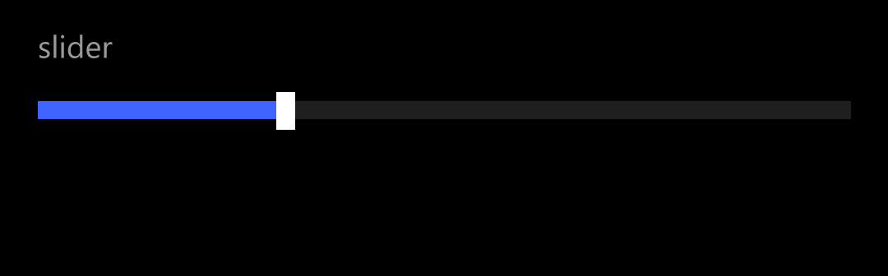
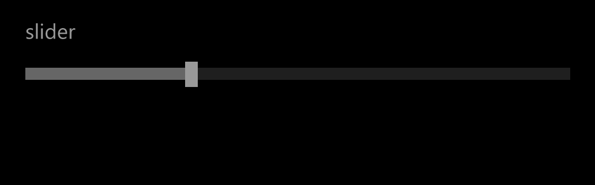
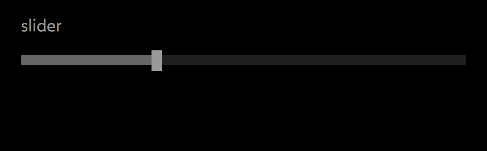
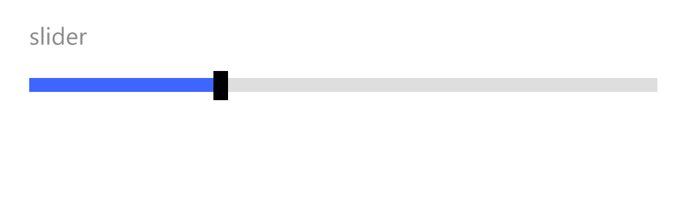
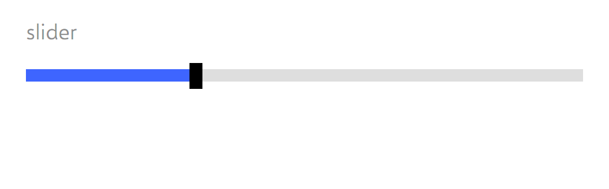
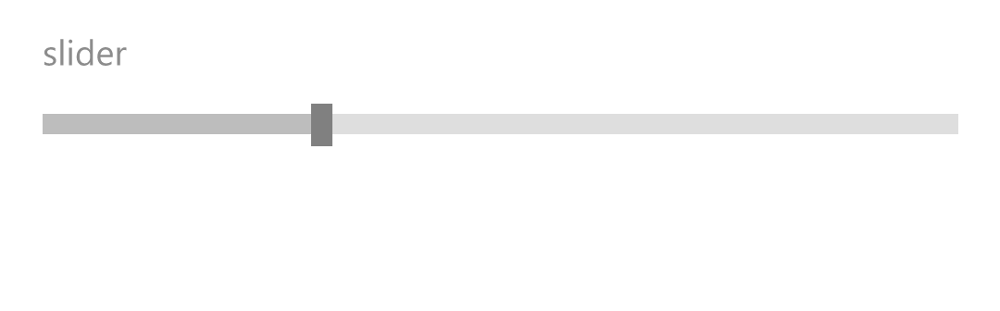
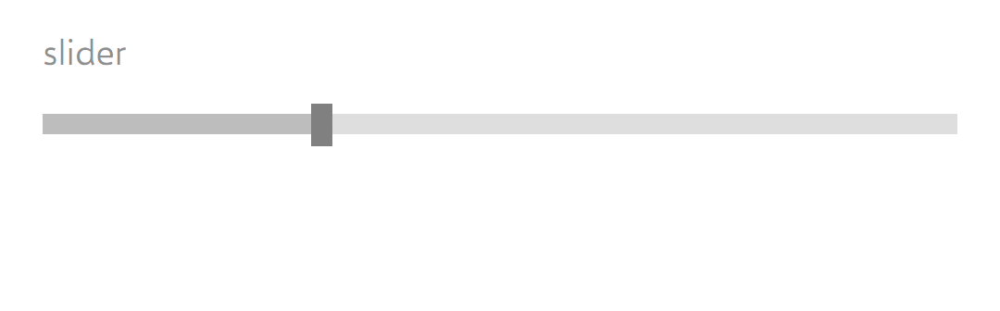

# Slider: comparison

**The phone:** the reference app's captures, Emulator 8.1 U1 1080P 5.5 inch (device 11), 1080 × 1920 at 2.4,
2026-11-08, in [`ref/wp81/Slider/`](../../../ref/wp81/Slider/README.md): `new Slider { Header = "slider", Value = 30 }`.
Segoe WP.
**Ours:** headless frames from `tests/Cornflower.Tests/Controls/SliderFrames.cs`, Avalonia 12.1.4 with Skia, on the
same stage: 450 × 140 at 2.4, the Slider stretched in a slot 19 in, 12 down and 19 from the right, with
`cf:ControlHeader.Header="slider"` and `Value` 30, in [`frames/`](frames). Selawik.

Text isn't compared by pixel: the fonts differ by design ([ADR 0001](../../decisions/0001-what-faithful-means.md)).
Sizes, positions and colours are compared by measurement, here and in the tests.

## Dark

| State | Phone | Ours |
|---|---|---|
| `base` |  |  |
| `Disabled` |  |  |

## Light

| State | Phone | Ours |
|---|---|---|
| `base` |  |  |
| `Disabled` |  |  |

`CommonStates.Normal` is byte for byte the phone's `base` in each theme, so it isn't shown. The template has no other
state.

## Measurements

In view pixels (DIP) unless raw pixels (px) are said. The phone's numbers are the dumps'; ours are `Bounds` and the
frames. The pixels are read on row 134 (through the track), column 200 (the decrease rect) and column 347 (the thumb).

| | Phone | Ours | |
|---|---|---|---|
| The Slider on the stage | 19.1667, 12.0833, 412.0833 × 127.9167 | 19.1667, 12.0833, 411.6667 × 127.9167 | **deliberate difference**, ADR 0003: the slot's margins, 45.6 px each, round to 46 here, so the Slider is 988 px wide, not 989 |
| The header | 21.6667 tall; its text at 0, 0, 21.28 tall | 21.6667 tall; its text at 0, 0, its line 21.28 (the text rounded to 21.6667) | **match** (Segoe WP's 1.33 em line of 16, `PhoneContentLine`) |
| The header's colour | `#99FFFFFF` dark, `#73000000` light, disabled too | the same | **match** |
| The container | 0, 21.6667, 106.25 tall | the same | **match** |
| The track, `HorizontalTrackRect` | 0, 39.1667, 412.0833 × 9.1667; px 46–1034, rows 123–144 | 0, 39.1667, 411.6667 × 9.1667; px 46–1033, rows 123–144 | the right end 1 px short, as above |
| The track's colour | `#FF1F1F1F` dark, `#FFDEDEDE` light, disabled too | the same, but one pixel at the stroke's inner edge, `#FF1E1E1E` (`#FFDDDDDD` light) | **match**, within one step a channel: the fill's own colour as a 1-wide stroke blends at its edge |
| The decrease rect | 0, 39.1667, 120.8333 × 9.1667; px 46–335 | the same, on the same pixels | **match**: (411.6667 − 9.5833) × 0.3 and (412.0833 − 9.5833) × 0.3 both round to 290 px |
| The decrease rect's colour | `#FF3E65FF`; disabled `#FF666666` dark, `#FFBDBDBD` light | the same | **match** |
| The thumb | 120.8333, 34.5833, 9.5833 × 19.1667; px 336–358, rows 112–157 | the same, on the same pixels | **match** |
| The thumb's colour | `#FFFFFFFF` dark, `#FF000000` light; disabled `#FF999999` dark, `#FF808080` light | the same | **match** |
| The border, `HorizontalBorder` | 57.0833 tall, 1 wide, transparent | the same | **match** |
| Not stretched, below the header | 57.1667, 137 px (no capture; from the template) | 57.5, 138 px | **deliberate difference**, ADR 0003: the 30.5 row is 73.2 px, rounded up to 74. Nothing is drawn there |

## Behaviours

| Behaviour | Evidence | Ours | |
|---|---|---|---|
| The style's values, dark and light | `slider.json`, the dumps | the same, by key | **match** |
| The bounds and pixels above | the dumps, the PNGs | above | **match**, with ADR 0003's rounding |
| Disabled dims the decrease rect and the thumb; the track, the border and the header stay | the template, the dumps, the PNGs | the same | **match** |
| No Pressed, PointerOver or focus state | the template; `Normal` = `base` | no pixel changes | **match** |
| The header and its template; none, no height | the template; WinRT's `Header` and `HeaderTemplate` | `cf:ControlHeader.Header` and `HeaderTemplate`, attached | **deliberate difference**: the API is attached (PLAN, "Decided"); what is drawn matches |
| A tap moves the thumb's middle to the finger | WinUI's `Slider::MoveThumbToPoint` (not measured on the phone) | Avalonia's `MoveToPoint`: the same formula | **match**, by source; a probe is owed |
| A press anywhere below the header takes the finger | the transparent `SliderContainer`; WinUI handles the press on it | the `Track` and its parts fill the container | **match**, by template and source |
| A drag follows the finger, off the Slider and past the ends | WinUI's `OnPointerMoved` with the pointer captured | the same | **match**, by source |
| A drag from the thumb | WinUI's `OnThumbDragDelta`: by the finger's travel | the thumb's middle to the finger on the first move | **gap**, recorded: at most 4.79 across (4.5 vertical), on the first move only |
| A value from input goes to the nearest whole number | WinRT's `StepFrequency`, 1 by default | wherever the finger is | **gap**, recorded: `StepFrequency` missing (PLAN, "Decided") |
| Reversed, the value fills from the other end | WinRT's `IsDirectionReversed` | Avalonia's `Track` | **match**, by the template; not captured |
| The vertical template | `slider.json` | the same parts and sizes | **match**, by the template; not captured |
| Outside ticks by `TickPlacement` | `slider.json`: 5 tall, 4.5 past the track's ends; WinUI's `TickBar`: from end to end | the same bars and places, Avalonia's `TickBar` | **match** in place, by template and source; their look (1 DIP and three quarters tall here, 1 px and full height in WinUI) is a **gap**, not measured. `Inline` is missing |
| The parts keep the Slider's themes | Wp81's `RepeatButton` theme (#30) is keyed by type | the parts set their own `Theme` | **match**: tested with it present |

## Known gaps

- **A drag from the thumb** jumps the thumb's middle to the finger on the first move, up to 4.79 (4.5 vertical).
- **`StepFrequency`** (and `SnapsTo`, `IntermediateValue`) are missing: input gives any value, not whole numbers.
  `IsSnapToTickEnabled="True" TickFrequency="1"` gives the phone's steps.
- **`Inline` ticks** are missing, and **the ticks' look** is unmeasured.
- **An underscore in a string header** is taken as an access key mark and not drawn.
- **Unmeasured**: the vertical Slider, ticks, no header and all input are from the template and WinUI's source; their
  captures and a probe are owed, and the device run.
