# TextBlock and the text styles: comparison

**The phone:** the reference app's captures, Emulator 8.1 U1 1080P 5.5 inch (device 11), 1080 × 1920 at 2.4,
2026-11-08, in [`ref/wp81/TextBlock/`](../../../ref/wp81/TextBlock/README.md). Segoe WP.
**Ours:** headless frames from `tests/Cornflower.Tests/Controls/TextBlockFrames.cs`, Avalonia 12.1.4 with Skia, on
the same stage: 450 × 120 at 2.4, the `TextBlock` 19 in and 12 down, in [`frames/`](frames). Selawik 1.01.

Text isn't compared by pixel: the fonts differ by design ([ADR 0001](../../decisions/0001-what-faithful-means.md)).
Sizes, positions and colours are compared by measurement, in [PLAN.md](PLAN.md#the-phones-line) and in the tests.

## Dark

| Style | Phone | Ours |
|---|---|---|
| `BaseTextBlockStyle` |  | 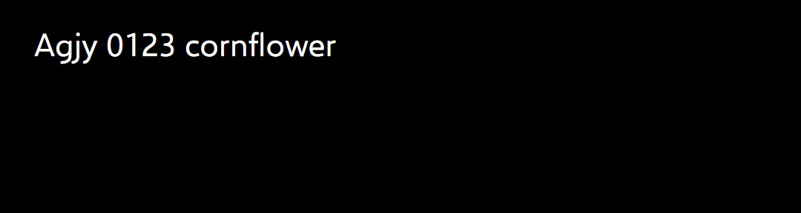 |
| `BodyTextBlockStyle` | 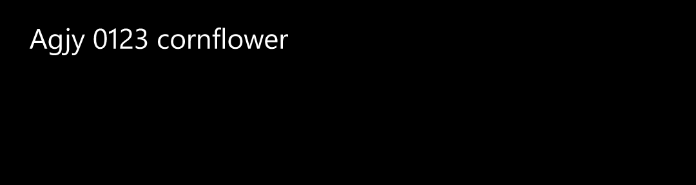 |  |
| `TitleTextBlockStyle` |  | 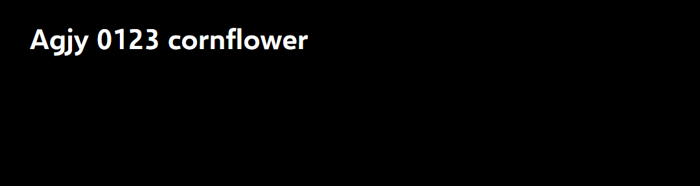 |
| `FlyoutPickerTitleTextBlockStyle` | 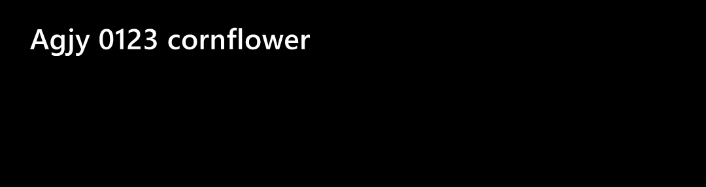 | 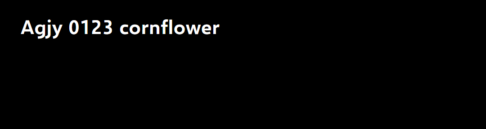 |
| `HeaderTextBlockStyle` | 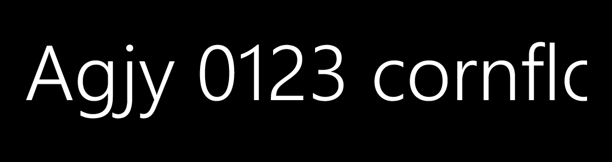 | 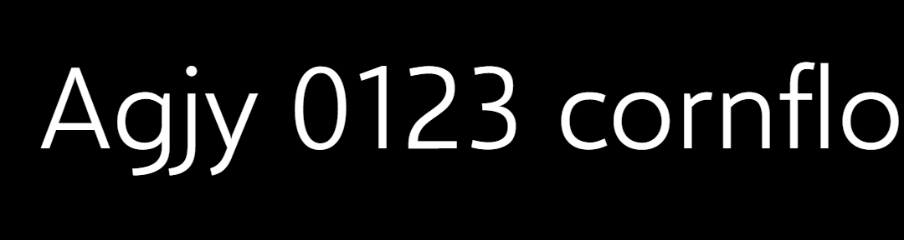 |
| `SubheaderTextBlockStyle` | 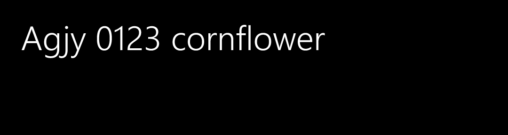 |  |
| `GroupHeaderTextBlockStyle` | 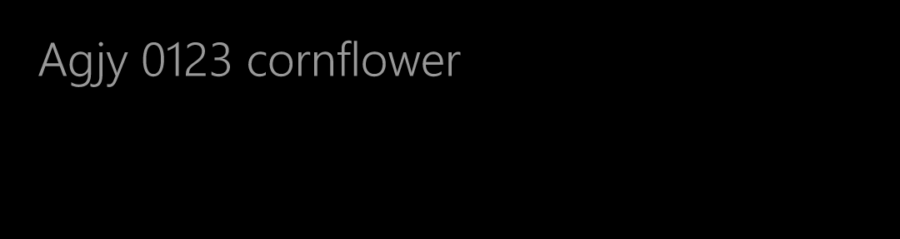 | 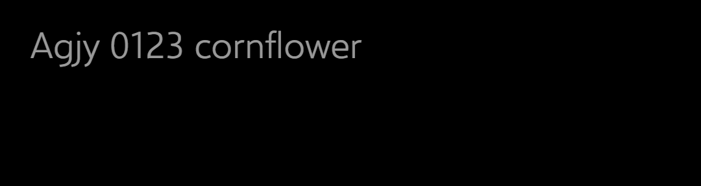 |
| `ControlHeaderTextBlockStyle` |  |  |
| `ControlContextualInfoTextBlockStyle` |  | 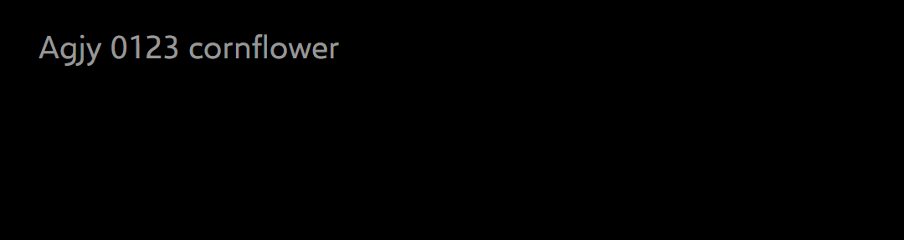 |
| `ListViewItemTextBlockStyle` |  | 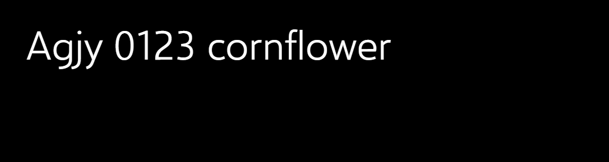 |
| `ListViewEmptyStaticTextBlockStyle` |  | 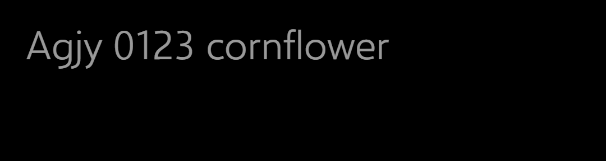 |
| `ListViewItemSubheaderTextBlockStyle` |  | 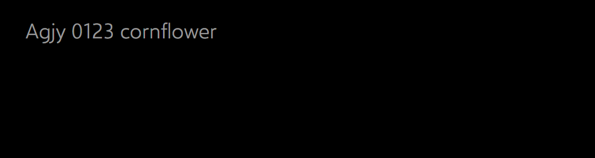 |
| `ListViewItemContentTextBlockStyle` | 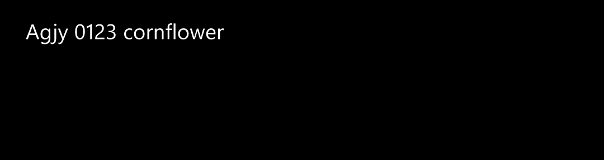 | 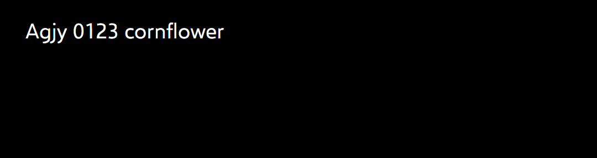 |
| `ComboBoxPlaceholderTextBlockStyle` | 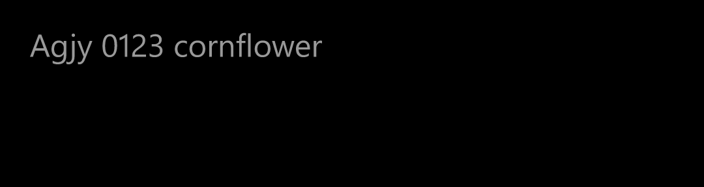 | 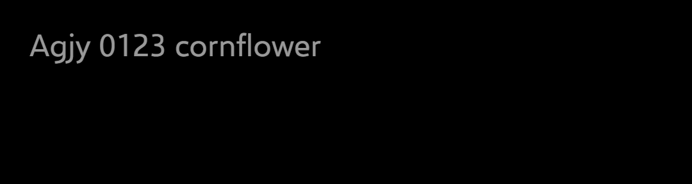 |

## Light

| Style | Phone | Ours |
|---|---|---|
| `BaseTextBlockStyle` | 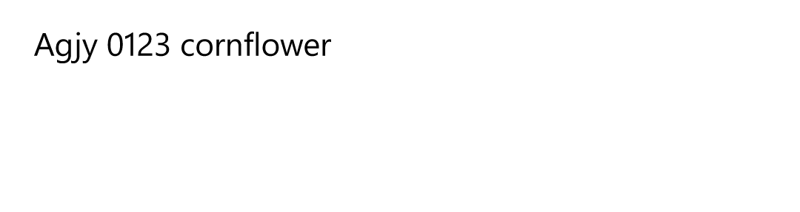 |  |
| `BodyTextBlockStyle` |  | 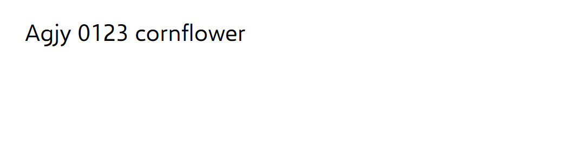 |
| `TitleTextBlockStyle` |  | 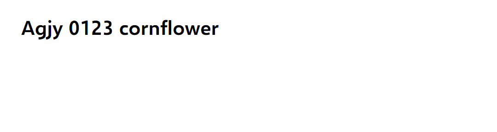 |
| `FlyoutPickerTitleTextBlockStyle` | 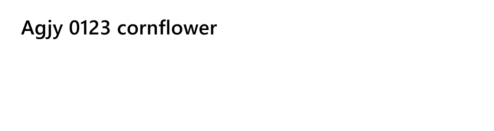 | 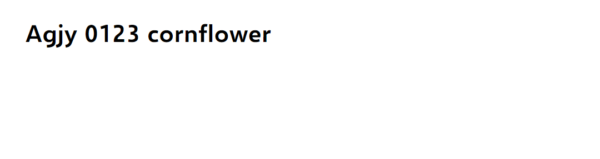 |
| `HeaderTextBlockStyle` | 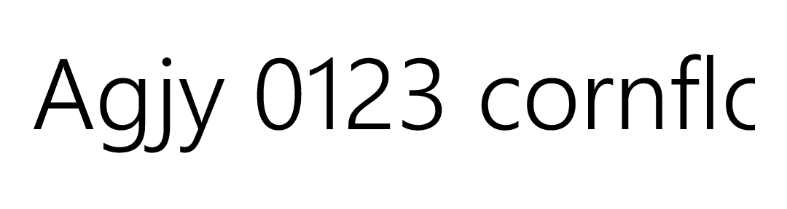 | 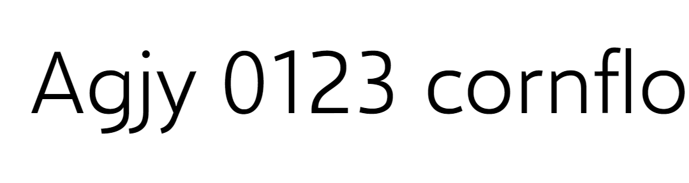 |
| `SubheaderTextBlockStyle` |  | 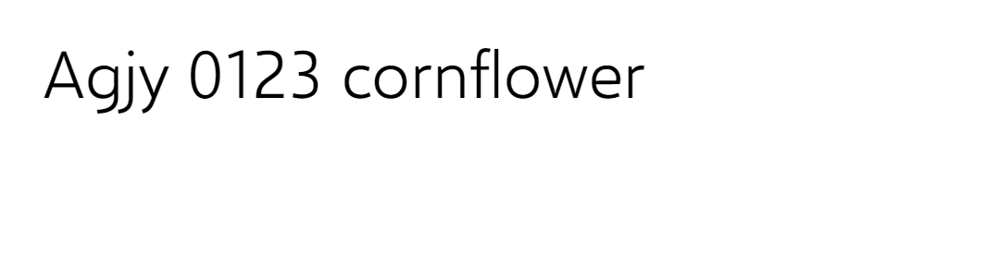 |
| `GroupHeaderTextBlockStyle` | 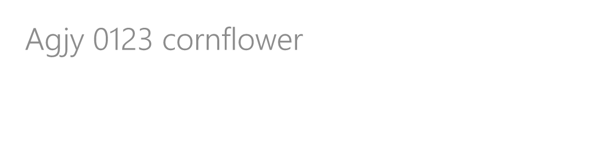 | 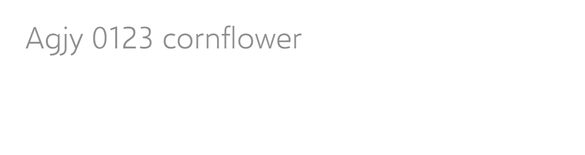 |
| `ControlHeaderTextBlockStyle` |  |  |
| `ControlContextualInfoTextBlockStyle` |  |  |
| `ListViewItemTextBlockStyle` |  | 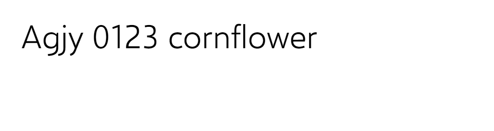 |
| `ListViewEmptyStaticTextBlockStyle` | 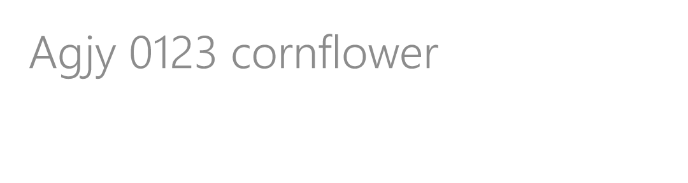 | 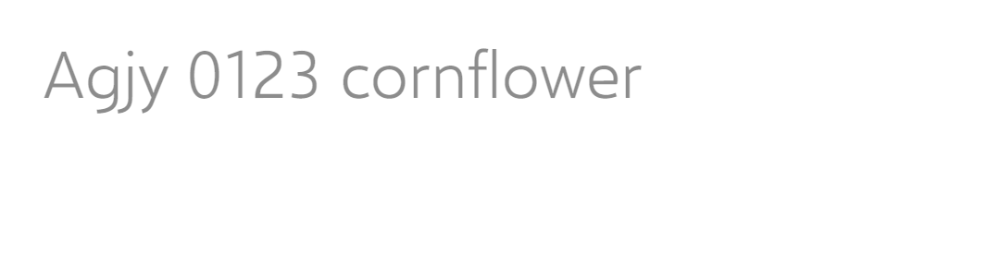 |
| `ListViewItemSubheaderTextBlockStyle` | 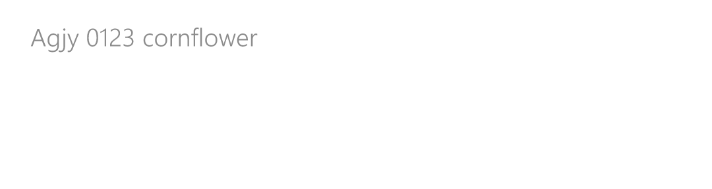 | 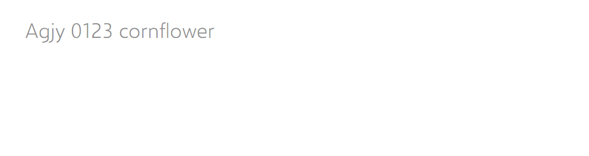 |
| `ListViewItemContentTextBlockStyle` |  | 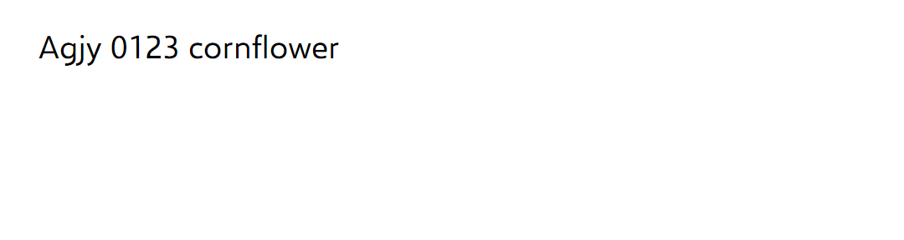 |
| `ComboBoxPlaceholderTextBlockStyle` | 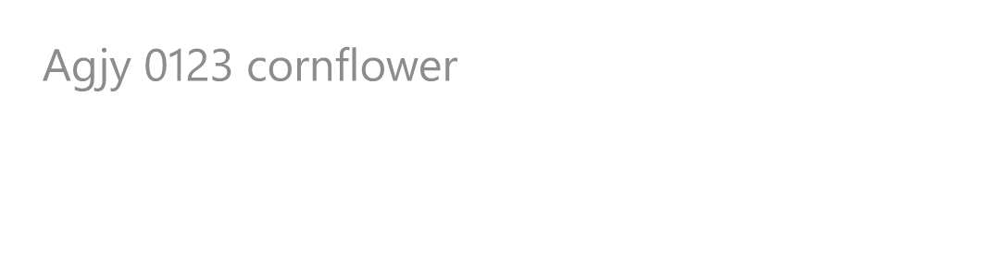 | 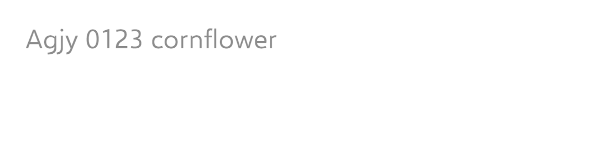 |

`MessageDialogTitleStyle` and `MessageDialogContentStyle` have frames of ours in [`frames/`](frames) but no capture.

## Behaviours

| # | Behaviour | Result | Measurement |
|---|---|---|---|
| 1 | Size, family, weight, wrapping, trimming, letter spacing, line height | **Match** | Each setter equals the dump's value; each style draws the face the phone's family has (Segoe WP SemiLight's one face for the SemiLight family, at any weight) |
| 2 | Height | **Match** | Unrounded, within 0.006 DIP of every dump. Laid out, within 1.2 raw pixels: see the rounding gap below |
| 3 | First baseline | **Match** for the 12 BaselineToBaseline styles; **deliberate difference** for the 2 MaxHeight ones | Computed: the phone's 1.0791 em to 0.001 DIP. Drawn: the "A"'s bottom row within one raw pixel of the phone's, 7 of 14 on the same row. MaxHeight: 0.025 em high (ADR 0003), 0.4 DIP at 16, which lands on the phone's row |
| 4 | Later lines `LineHeight` apart | **Match**, by the template's definition | No capture has two lines (see the plan's owed captures) |
| 5 | Character spacing | **Match** | n × `FontSize` / 1000: −0.071 at 23.73, +0.272 at 18.14 |
| 6 | WrapWholeWords | **Match** | A word longer than the line runs past it, as `WrapWithOverflow` |
| 7 | Descenders below a short line | **Match** | Header's ink ends 75.833 below its top; the phone's 75.417, one pixel apart |
| 8 | Colour, dark and light | **Match** | Brushes equal the dumps' `foreground` (#FFFFFFFF, #99FFFFFF; #FF000000, #73000000), ComboBoxPlaceholder's `Opacity` 0.6 and 0.45. The farthest ink pixel equals the phone's (255, 153; 0, 140) at 18 DIP and up; at 16 DIP it falls up to 3 short, as no Selawik stem covers a whole pixel there |
| 9 | Local `FontSize`, the app's own values, taking the style away | **Match** (WinRT's behaviour, as each setter is a style value) | Tests |
| 10 | The hooks | Cornflower's (ADR 0004) | Every value by `DynamicResource`; a key in a 1280-wide window's `Resources` changes the style, and another window keeps the phone's |
| 11 | No phone width | Cornflower's (ADR 0004) | No width setter; in a 1280-wide window, wrapped text fills 1,242 DIP |

## Gaps and deliberate differences

- **Optical margin.** The phone trims the first glyph's left side bearing (`OpticalMarginAlignment="TrimSideBearings"`
  on every style based on `BaseTextBlockStyle`); Avalonia has nothing like it. The "A" starts 1.25 DIP (3 raw
  pixels) right of the phone's in `HeaderTextBlockStyle`, 0.42 in `GroupHeaderTextBlockStyle`,
  `ListViewEmptyStaticTextBlockStyle`, `ControlHeaderTextBlockStyle`, `ControlContextualInfoTextBlockStyle`,
  `ListViewItemTextBlockStyle` and `SubheaderTextBlockStyle`, 0.42 left of it in `ListViewItemContentTextBlockStyle`
  (which doesn't trim), and on the same column in the other five. It depends on
  the first glyph, so a fixed margin can't take it. A known gap.
- **Text past a `NoWrap` line's end isn't clipped.** WinRT clips an element to its layout slot when it's larger;
  Avalonia has no layout clip, only `ClipToBounds`, which would also cut the descenders the phone draws below
  a short line (2.9 DIP of Header's "gjy"). The styles turn it off, so Header's specimen, wider than its 412 DIP
  slot, runs on to the window's edge (ours "cornflo", the phone's "cornflc", clipped at 431.25 DIP). Where that
  matters, the container clips, as a list item's does, or the app sets `ClipToBounds` or `TextTrimming` on the
  `TextBlock`. A deliberate difference.
- **Rounding.** Avalonia rounds each `Padding` edge to the nearest raw pixel and the text's height up, where the
  phone rounds the whole to the nearest: laid-out heights differ by −0.15 to +0.47 DIP (ADR 0003's recorded
  rounding deviation).
- **MaxHeight baseline**, 0.025 em high: ADR 0003.
- **The text-size setting.** The phone scales text by the user's Ease of Access setting
  (`IsTextScaleFactorEnabled`); Avalonia has no such setting. Not declared.
- **Not captured:** the two MessageDialog styles, and two-line text. Owed to the reference app.
