# ToggleButton: comparison

**The phone:** the reference app's captures, Emulator 8.1 U1 1080P 5.5 inch (device 11), 1080 × 1920 at 2.4,
2026-11-08, in [`ref/wp81/ToggleButton/`](../../../ref/wp81/ToggleButton/README.md). Segoe WP Semibold. Each is a state
forced on a fresh instance, with no finger.
**Ours:** headless frames from `tests/Cornflower.Tests/Controls/ToggleButtonFrames.cs`, Avalonia 12.1.4 with Skia, on the
same stage: 450 × 100 at 2.4, the ToggleButton in a slot 19 in and 12 down, in [`frames/`](frames). Selawik Semibold.
Ours reaches each state as an app does: checked, disabled, or pressed by a mouse at its centre.

Text isn't compared by pixel: the fonts differ by design ([ADR 0001](../../decisions/0001-what-faithful-means.md)).

## Dark

| Look | Phone | Ours |
|---|---|---|
| Unchecked (`base`; also `Normal`, `PointerOver`, `Pressed`, the three `Indeterminate`s) |  | 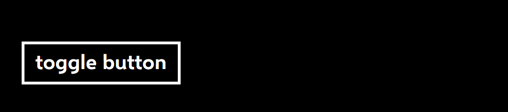 |
| Checked (`base`; also `CheckedPointerOver`) | 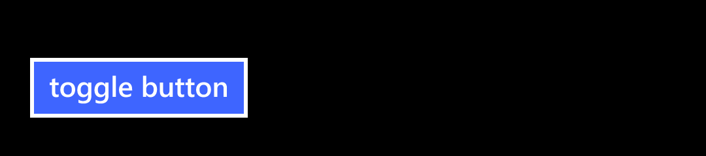 | 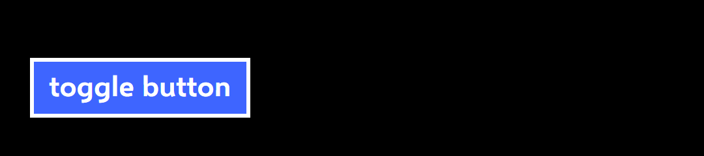 |
| `CheckedPressed`: the unchecked look |  |  |
| `Disabled` (also `IndeterminateDisabled`) | 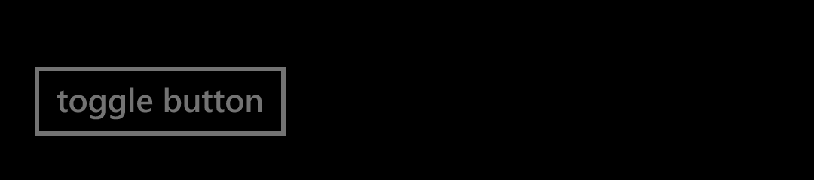 | 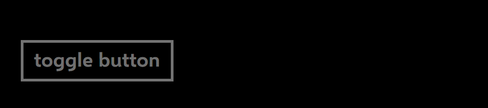 |
| `CheckedDisabled` |  |  |

## Light

| Look | Phone | Ours |
|---|---|---|
| Unchecked | 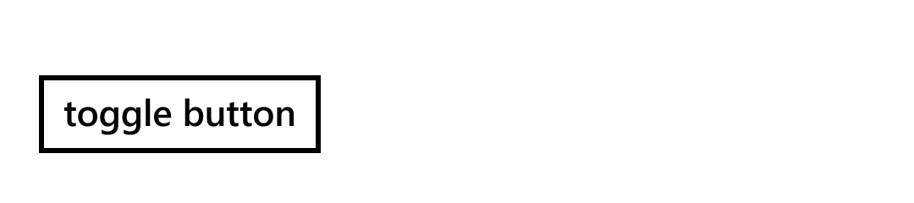 |  |
| Checked | 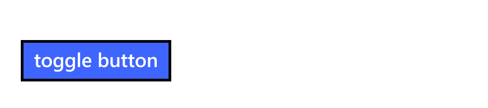 | 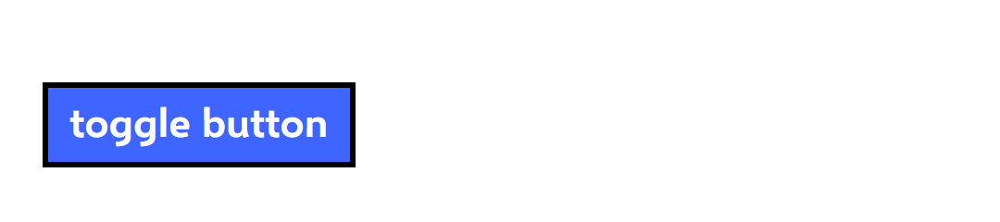 |
| `CheckedPressed` |  | 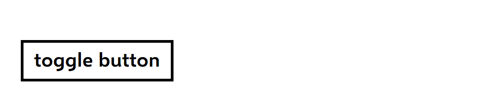 |
| `Disabled` |  | 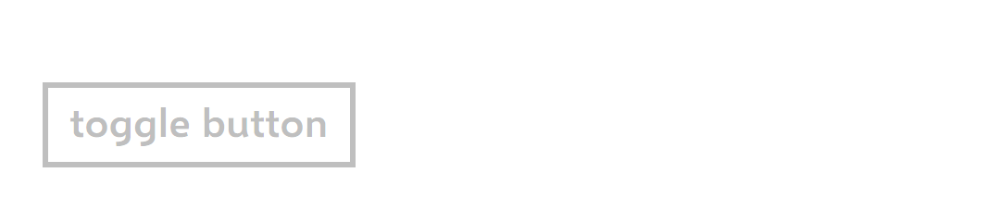 |
| `CheckedDisabled` | 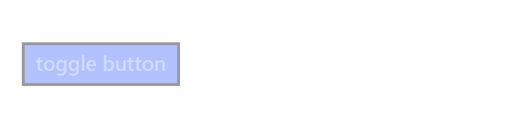 |  |

## Measurements

In view pixels (DIP) unless raw pixels (px) are said. The phone's numbers are the dumps' and the PNGs'; ours are
`Bounds` and the frames.

| | Phone | Ours | |
|---|---|---|---|
| The ToggleButton on the stage | 19.1667, 27.5, 138.75 × 57.5 | 19.1667, 27.5, 140.8333 × 57.5 | **match** but the width: Selawik's "toggle button" is 2.08 wider |
| `EnabledBackground` in it | 0, 9.5833, full width × 38.3333 | the same | **match** |
| The content's top, height | 15, 24.1667 | the same | **match** (the phone's 1.33 em line, ADR 0003) |
| The border, unchecked and checked | columns 46–51, rows 89–94 and 175–180 (right edge 373–378, the text's width); `#FFFFFFFF` dark, `#FF000000` light | the same columns and rows (right edge 378–383); the same colours | **match**, every pixel read |
| Checked: the fill | `#FF3E65FF`, both themes | the same, brush and pixels (52 and 56, 135; 60, 95 and 174) | **match** |
| `Disabled`: border, inside | `#FF737373` dark, `#FFBFBFBF` light; the page inside | the same | **match** |
| `CheckedDisabled`: border, fill | `#FF666666` and `#FF192866` dark; `#FF999999` and `#FFB2C1FF` light | `#FF666666` and `#FF182866` dark; `#FF989898` and `#FFB1C1FF` light | **match** within one step of rounding |
| `CheckedDisabled`: the text | the border's grey: one layer at 0.4 | the same: one layer (`RequiresFullOpacityHandling`) | **match**; without it the border's inner half was `#FF747EA3` |
| Pressed, checked or not | the unchecked look (the template; the probe's states) | the same | **match** |
| Slid off while pressed, checked | `CheckedPressed` › `Checked` at the edge; no toggle on a lift off it | the accent again off it; no toggle | **match** |
| The tilt | none | none | **match** |

## Behaviours

| # | Behaviour | Result |
|---|---|---|
| 1 | The style's values | **Match**: each setter as `togglebutton.json`'s key and the dump; `ClickMode` and `IsThreeState` as the probe read |
| 2 | Bounds | **Match** but the text's width |
| 3, 4 | Unchecked and Checked | **Match**, every pixel read, dark and light |
| 5 | Pressed shows the unchecked look; the release toggles | **Match** |
| 6 | Sliding off a pressed checked one | **Match** |
| 7 | The pointer over it changes nothing | **Match** |
| 8 | Disabled | **Match** |
| 9 | CheckedDisabled | **Match** within one step |
| 10 | Indeterminate | **Match**: the template's; not captured as an app sets it (the captures force the state) |
| 11–15 | Variant, no tilt, the overhang, focus, the line and access keys | **Match**, or as Button's (access keys) |
| 16, 17 | Subclasses and holes | Not on the phone: Avalonia's lookup, held by tests |

## Gaps and deliberate differences

- **One Border and one presenter**, where the phone has two of each: the same pixels, but a style of an app's that
  reaches into the template for `DisabledBackground` or `DisabledContent` finds nothing.
- **The text is Selawik**: "toggle button" 2.08 wider, its baseline 0.44 high (ADR 0003), as Button's.
- **Access keys** are Avalonia's, as Button's: a deliberate difference.
- **Not captured**: a real press (the template and the probe agree it looks unchecked), and a finger sliding back onto a
  pressed ToggleButton (ours shows the unchecked look again, by the template's rule).
