# ToggleSwitch: comparison

**The phone:** the reference app's captures, Emulator 8.1 U1 1080P 5.5 inch (device 11), 1080 × 1920 at 2.4,
2026-11-08, in [`ref/wp81/ToggleSwitch/`](../../../ref/wp81/ToggleSwitch/README.md): `off` and `on` with the header
"toggle switch", and `no-header`. Segoe WP. The motion is the touch probes' and the recordings' (tools/refapp/README.md,
"Motion").
**Ours:** headless frames from `tests/Cornflower.Tests/Controls/ToggleSwitchFrames.cs`, Avalonia 12.1.4 with Skia, on
the same stages: 450 × 140 (110 without a header) at 2.4, the switch in a slot 19 in, 12 down and 19 from the right,
with `cf:ControlHeader.Header="toggle switch"`, in [`frames/`](frames). Selawik.

Text isn't compared by pixel: the fonts differ by design ([ADR 0001](../../decisions/0001-what-faithful-means.md)).
Sizes, positions and colours are compared by measurement, here and in the tests.

## Dark

| Switch, state | Phone | Ours |
|---|---|---|
| `off`, `base` | 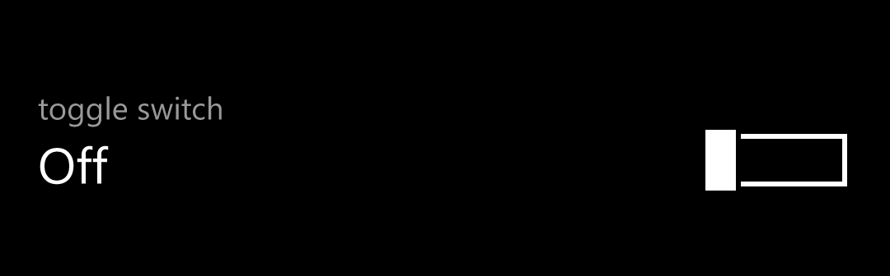 | 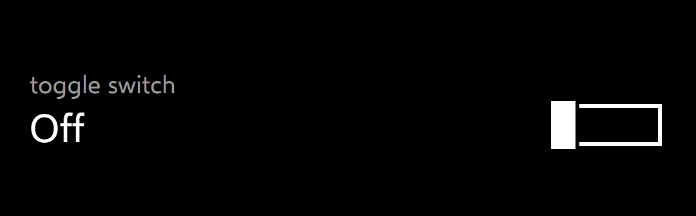 |
| `on`, `base` |  | 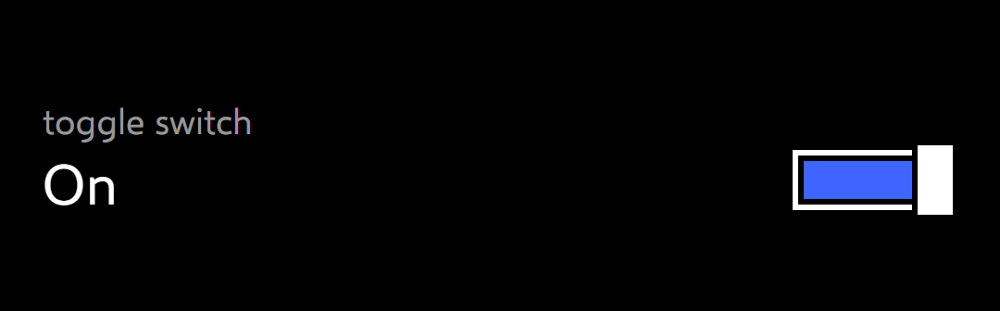 |
| `no-header`, `base` |  | 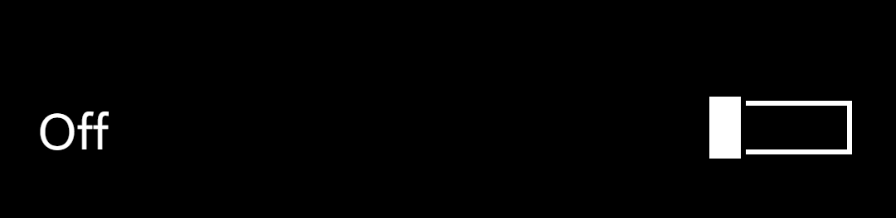 |
| `off`, `Disabled` | 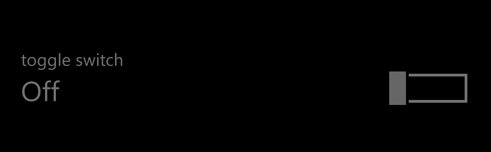 | 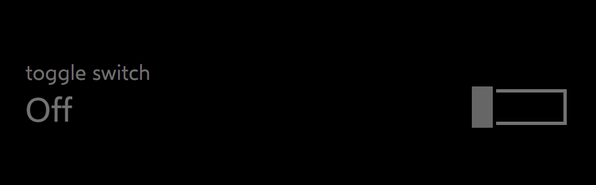 |
| `on`, `Disabled` | 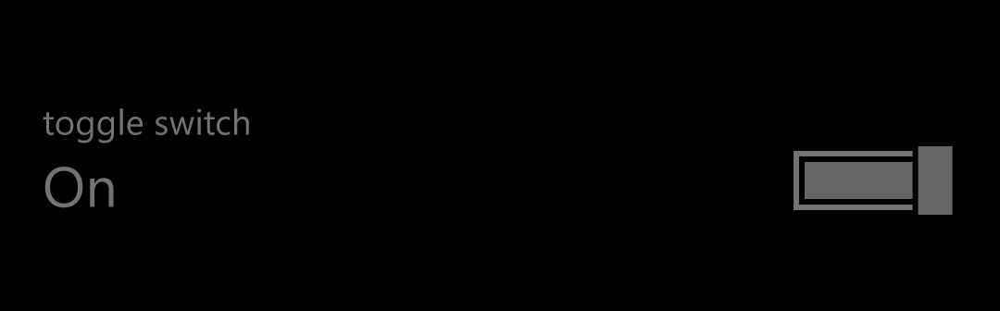 | 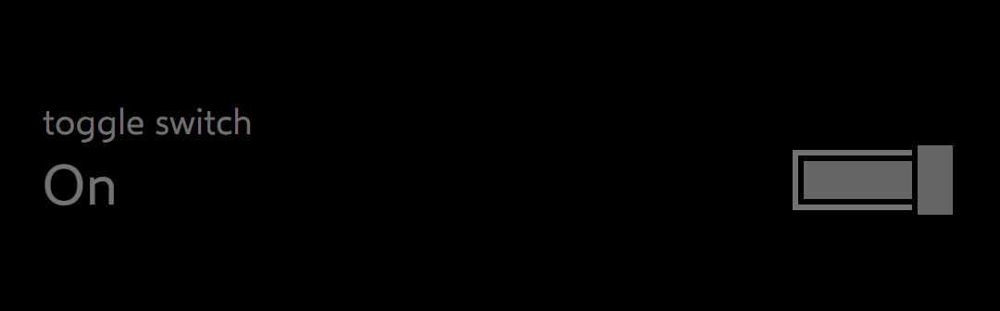 |
| `no-header`, `Disabled` |  | 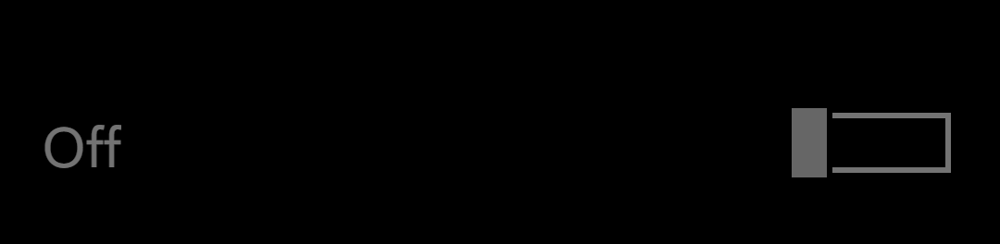 |

## Light

| Switch, state | Phone | Ours |
|---|---|---|
| `off`, `base` | 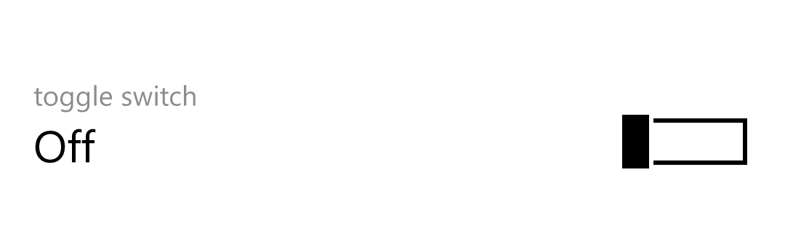 | 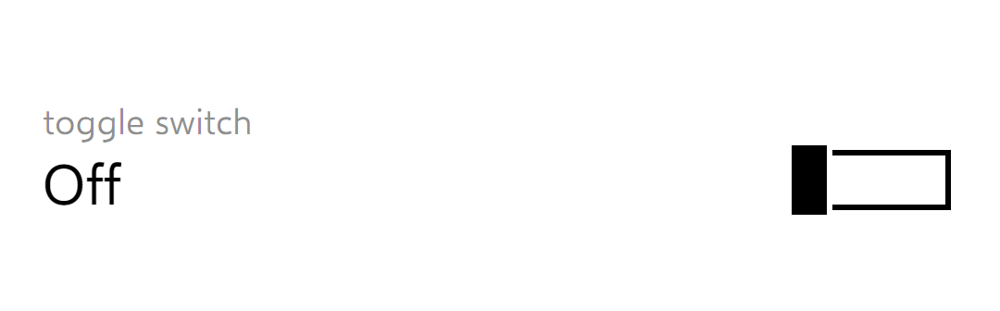 |
| `on`, `base` | 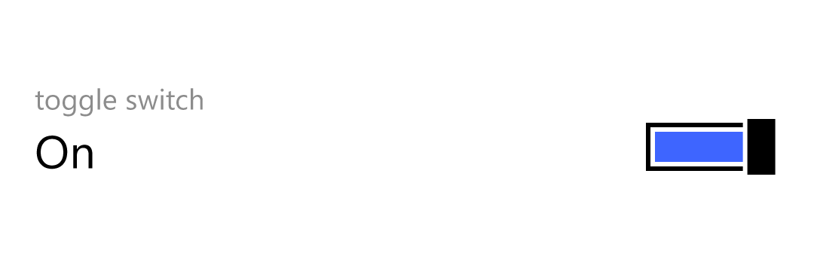 | 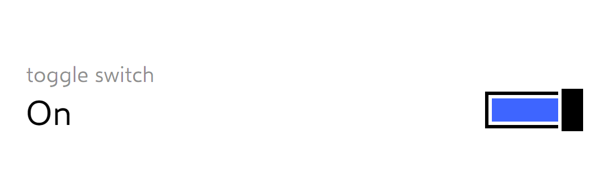 |
| `no-header`, `base` | 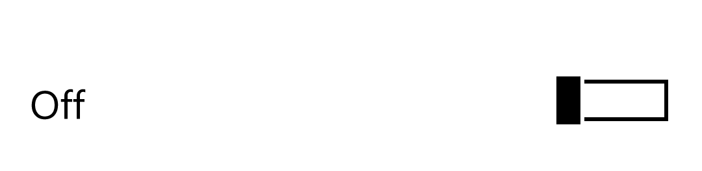 | 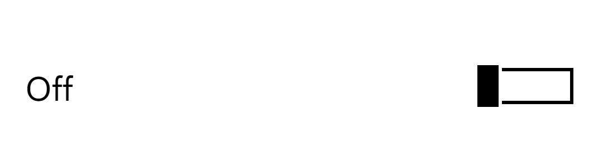 |
| `off`, `Disabled` | 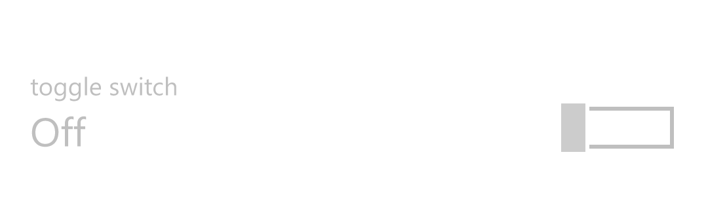 | 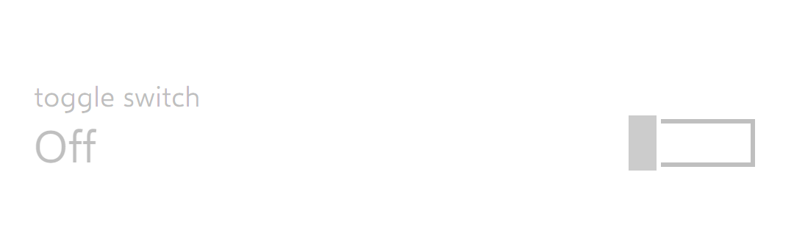 |
| `on`, `Disabled` |  | 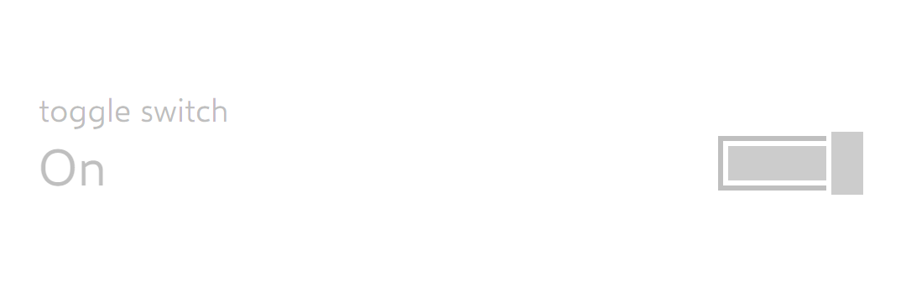 |
| `no-header`, `Disabled` |  |  |

`CommonStates.Normal` is byte for byte the phone's `base`, so it isn't shown; `PointerOver` and `Pressed` set nothing.

## Measurements

In view pixels (DIP) unless raw pixels (px) are said. The phone's numbers are the dumps'; ours are `Bounds` and the
frames. The pixels are read on row 180 (through the switch, with a header), column 950 (the outer border and the
curtain) and column 1010 (the knob, on).

| | Phone | Ours | |
|---|---|---|---|
| The switch on the stage | 19.1667, 43.3333, 412.0833 × 65.4167 | 19.1667, 43.3333, 411.6667 × 65.4167 | **deliberate difference**, ADR 0003: the slot's margins, 45.6 px each, round to 46 here, so the switch is 988 px wide, not 989 |
| The header | 21.6667 tall; text 21.28; `#99FFFFFF` dark, `#73000000` light | the same, its line 21.28 | **match** (`PhoneHeaderLine`) |
| The content | at 21.6667, 34.1667 tall; text 33.9167 | the same, its line 33.915 | **match** |
| No header | 61.6667 tall, the first row 17.9167, half the switch | 62.0833, the first row 18.3333, half ours | **deliberate difference**, ADR 0003: the switch is 87 px tall, not 86 |
| The switch, `SwitchKnobBounds` | 335, 20, 77.0833 × 35.8333 (86 px) | 334.5833, 19.5833, 77.0833 × 36.25 (87 px) | ADR 0003: 86.4 px rounded up. One px taller, at the top: the outer border's top on rows 162–167, not 163–168; its bottom the same, 221–226 |
| `OuterBorder` | 2.9167, 4.5833 in it, 71.25 × 26.6667, 2.5 | 2.9167, 4.5833, 71.25 × 27.0833, 2.5 | as above |
| The curtain's clip | 61.25 × 16.6667 | 61.25 × 17.0833 | as above |
| The knob | 20.4167 (49 px) × 35.8333 | 20.8333 (50 px) × 36.25 | ADR 0003: 49.2 px rounded up. Off, its fill on px 855–892, the phone's 856–892 |
| The knob's travel | `KnobOnToOffOffset` 56.6667, 136 px | 56.6667, 136 px | **match** |
| Where the knob rests, on | the template's 56.5, 135.6 px, by a render transform: its fill on px 992–1027, 991 and 1028 part-covered | 136 px, on whole pixels: its fill on px 991–1028 | **deliberate difference**: Avalonia places the knob by layout, on the pixel grid, at the travel |
| The curtain, on | the accent `#FF3E65FF` on px 869–984, under the knob's stroke from 985.6 | px 868–984, under the knob's stroke from 985 | **match**, a px further left as the switch is |
| The outer border | `#FFFFFFFF` dark, `#FF000000` light, 6 px: on px 857–862 and 1022–1027 | the same colours, 6 px: on px 856–861 and 1021–1026 | **match**, a px further left |
| The knob's colours | `#FFFFFFFF` with a `#FF000000` stroke dark, `#FF000000` with `#FFFFFFFF` light | the same | **match** |
| Disabled | the header, the words and the outer border `#73FFFFFF` (`#40000000` light); the knob and the curtain `#FF666666` (`#FFCCCCCC`) | the same; in the frame `#FF737373` and `#FF666666` dark, as the phone's | **match** |

## Behaviours

| Behaviour | Evidence | Ours | |
|---|---|---|---|
| The style's values, dark and light | `toggleswitch.json`, the dumps | the same, by key | **match** |
| The bounds and pixels above | the dumps, the PNGs | above | **match**, with ADR 0003's rounding |
| `ContentStates`: the words for the state | the template | `:unchecked`, `:checked` | **match** |
| Disabled | the template, the dumps, the PNGs | the same keys | **match** |
| No `PointerOver`, `Pressed` or focus look | the template; `Normal` = `base` | no pixel changes | **match** |
| The header | WinRT's `Header`, `HeaderTemplate` | `cf:ControlHeader.Header`, `HeaderTemplate`, attached; Avalonia's `Content` in its place without one | **deliberate difference**: the API (PLAN, "Decided"); what is drawn matches |
| A press is a drag at once: the knob follows one for one from the first move | #25's probes | the same, from 0.5 px | **match** |
| The knob stays between its rests; past an end, the finger comes back first | #25's probes; WinUI's `MoveDelta` | the same | **match** |
| A tap toggles: under 2.7 mm and no event at 1,000 ms | #25's and #33's probes: 17.47 px tapped, 18.33 didn't; an event at 984 ms tapped, one at 1,000 didn't | 17.86 px, 1,000 ms on `CornflowerClock`, the release counted too | **match** within the probes' readings; the release decided (PLAN) |
| A tap that moved the knob: back at once, then the slide | the probes: `Dragging` > `Off` at once, `Off` > `On` 380 ms later | the same | **match** |
| A drag's release: over past half the travel | 28.32 back off, 28.35 on (device 11) | the same | **match** |
| From on, the line | no probe; WinRT's code: 0.17 nearer, from 56.5 | half the travel back | **deliberate difference**, unmeasured (PLAN) |
| The slide | `KeySpline` 0.1,0.9 0.2,1 over 370 ms (#66), after a tap, a drag and a change from code | `KnobTransitions`, the same curve, after each | **match**, at its end value (ADR 0003) |
| Only the `SwitchThumb` takes the finger | the template; WinUI's source | the same, but past the switch's right edge | **deliberate difference**: the phone's Thumb reaches 13.5 past the control's right edge; Avalonia hit-tests nothing outside a control's bounds (measured headless), so a tap there misses |
| A drag on the switch never scrolls its page | `ManipulationMode` None | `PhoneNoManipulation` | **match** |
| The keyboard | WinUI's source: Space | Avalonia's: Space and Enter | **gap**, unmeasured |
| `:dragging` | the phone's `Dragging` sets nothing | not raised | **gap**: Avalonia's pseudoclass, which only its own drag sets |
